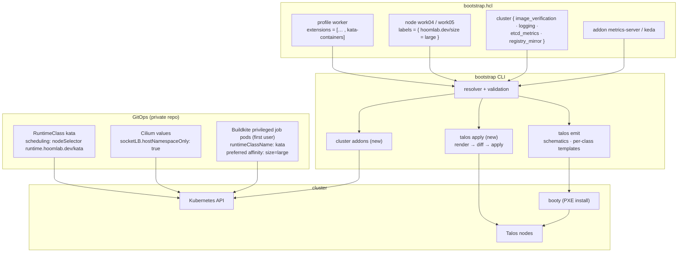
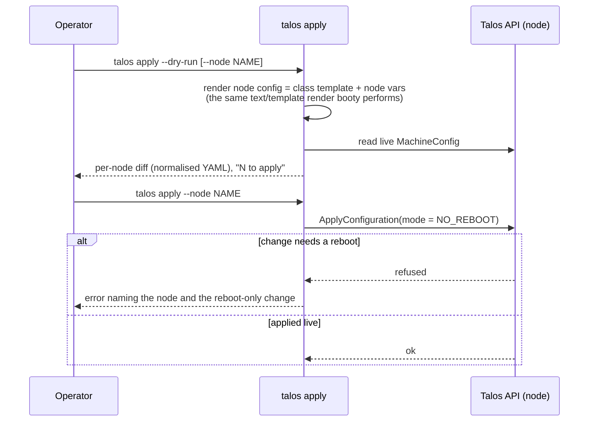
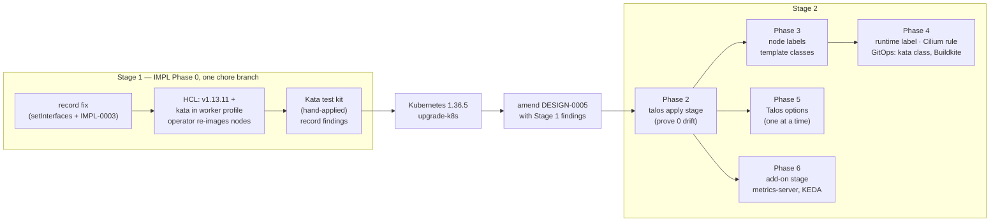

<!-- markdownlint-disable-file MD025 MD041 -->

# DESIGN-0005: Talos 1.13.11 upgrade with Kata CI isolation and cluster options

<!--toc:start-->
- [Overview](#overview)
- [Goals and Non-Goals](#goals-and-non-goals)
  - [Goals](#goals)
  - [Non-Goals](#non-goals)
- [Background](#background)
  - [Where the cluster is today](#where-the-cluster-is-today)
  - [Facts that shape the design](#facts-that-shape-the-design)
  - [Stage 1 findings](#stage-1-findings)
- [Detailed Design](#detailed-design)
  - [How the pieces fit](#how-the-pieces-fit)
  - [Two stages](#two-stages)
  - [Phase 0 — correct the setInterfaces record](#phase-0--correct-the-setinterfaces-record)
  - [Phase 1 — Talos 1.13.11](#phase-1--talos-11311)
  - [Phase 2 — day-2 apply stage](#phase-2--day-2-apply-stage)
  - [Phase 3 — node labels](#phase-3--node-labels)
  - [Phase 4 — runtimes: Kata per workload](#phase-4--runtimes-kata-per-workload)
  - [Phase 5 — Talos-side options](#phase-5--talos-side-options)
  - [Phase 6 — cluster add-on options](#phase-6--cluster-add-on-options)
- [API / Interface Changes](#api--interface-changes)
- [Data Model](#data-model)
- [Testing Strategy](#testing-strategy)
- [Migration / Rollout Plan](#migration--rollout-plan)
- [Open Questions](#open-questions)
- [References](#references)
<!--toc:end-->

## Overview

Following INV-0004, this design keeps the cluster on Talos 1.13 and
does four things:

- upgrades it to the last 1.13 patch, **v1.13.11**;
- corrects a wrong rationale in the record;
- adds the first workload-isolation tier: **Kata Containers baked into
  every worker image**. A pod that needs the extra isolation opts in
  with `runtimeClassName: kata` and runs on any worker. The first users
  are CI jobs, but nothing about Kata is CI-specific. runc stays the
  default everywhere;
- turns the useful Sidero guides into **opt-in HCL options**.

> **Amended and approved at the Phase 2 gate, 2026-10-19.** Stage 1
> is done, and every open question was answered with its recommended
> option (a). Its
> findings are in [Stage 1 findings](#stage-1-findings), and the
> sections they contradicted have been corrected in place. The
> direction change of 2026-10-17 is now the design: there is **no
> dedicated, tainted CI pool**.
>
> - Kata is opt-in per workload, CI or not.
> - Placement is a separate concern. It is handled by labels and
>   preferred affinity, not taints: work04/05 are the large workers
>   (16 cores, 32 GiB, against 8 and 16 for work01–03), and big
>   services should keep using them.
> - CI is moving from ARC to self-hosted Buildkite (`agent-stack-k8s`,
>   with a separate privileged controller), which sets the
>   RuntimeClass per controller.
>
> Phase 3 is now labels only, and Phase 4 publishes one `kata`
> RuntimeClass. The file name and title keep "CI isolation" so that
> links stay stable.

The options are: image signature verification, Talos log shipping,
the etcd metrics endpoint, a pull-through registry mirror,
metrics-server, and KEDA.

The options are off unless declared. The intent is that a first
bootstrap sets none of them, an operator turns them on in
`bootstrap.hcl` to test, and later the hoomlab / platformctl service
enables them itself after its first bootstrap. The 1.14 move is
DESIGN-0006's job. Everything here is built so that only the renderer
changes when it lands.

The work runs in **two stages** (decided 2026-10-11):

- **Stage 1** is the upgrade and image work. Talos 1.13.11 goes on with
  Kata baked into the worker image, plus a hand-applied Kata test. It
  is config lines, not code, done on its own chore branch as Phase 0
  of the IMPL.
- **Stage 2** is everything else: the apply stage, node labels,
  the runtime label, the Cilium rule, the options, and the add-ons.
  It is designed here, but **revisited against Stage 1's findings**
  before any of it is built.

## Goals and Non-Goals

### Goals

- **G1** — Stage 1: fix the `setInterfaces` comment and the IMPL-0003
  Phase 2 note (the network documents *do* exist in 1.13 machinery).
- **G2** — Stage 1: Talos v1.13.11 with Kata in the worker image,
  machinery v1.13.11, a runbook for the in-place node upgrades, and a
  hand-applied Kata test whose findings shape Stage 2.
- **G3** — a delivery path for day-2 options to **live** nodes. Today
  the CLI only feeds booty templates, which a node reads once, at
  install.
- **G4** — a per-node scheduling primitive: node labels, validated at
  load against what Kubernetes will actually accept. Taints are
  deferred until something needs to repel pods (OQ-4).
- **G5** — Kata available on every worker, through the worker
  profile's extensions. A stable runtime label is derived from the
  extension's presence, and validation ties it to the Cilium values it
  needs.
- **G6** — opt-in Talos-side options: image verification, logging,
  etcd metrics, registry mirror.
- **G7** — opt-in cluster add-ons: metrics-server and KEDA, with a
  documented Temporal scaler pattern.

### Non-Goals

- **Changing the default runtime.** runc is Talos's containerd
  default and stays the only default. A node never runs everything
  under Kata. Pods opt in with `runtimeClassName`. Making a sandbox
  runtime a node's default would push Cilium, the CSI node plugin,
  and every `hostNetwork` DaemonSet into a VM or netstack they can't
  run in.
- **gVisor, crun, NVIDIA.** All three are deferred and not installed;
  Kata is the isolation actually needed (decided 2026-10-11).
  - gVisor would need the `user.max_user_namespaces` sysctl on every
    node.
  - crun is a runc alternative with little isolation value.
  - NVIDIA is hardware-tied: it needs GPU PCI passthrough, which
    `pve vms` doesn't model, and the GPU host may be repurposed. When it
    returns it is a per-node profile, not part of the worker image.
  - The runtime table (Phase 4) takes each of them later as one row.
- **Talos workload isolation (`sandboxd`).** It is 1.14-only; see
  DESIGN-0006.
- **RuntimeClass objects, CI runner config, `ScaledObject`s.** These
  are workload-side and live in GitOps. This design states the
  contract they rely on (OQ-9, OQ-19).
- **Proxmox HA and load-balancer policy for Kata VMs.** It's
  documented as an operator constraint; nothing here automates it.

## Background

### Where the cluster is today

| Fact | Value |
| ---- | ----- |
| Talos / Kubernetes | v1.13.8 / v1.36.3 |
| Default runtime | runc, everywhere; no RuntimeClasses |
| CI | ARC runners, BuildKit, Buildkite. The first two run in `privileged` Pod Security namespaces and Buildkite in `baseline`, all under runc. *Since then (2026-10-17):* ARC is being retired for Buildkite `agent-stack-k8s` 0.51.0, which runs two controllers, one unprivileged (`baseline`) and one privileged (`privileged`). |
| Nested virtualisation | Guests see `vmx`, because bootstrap creates VMs with `cpu = host`. `/dev/kvm`, `/dev/vhost-vsock`, and `/dev/vhost-net` already exist on workers. |
| Cilium | v1.20.1, KPR. `bpf-lb-sock-hostns-only = true` live, **forced by `gatewayAPI.enabled`**, not set in the values file. Bandwidth manager off. |
| Node scheduling | No worker carries a taint or a custom label today; only the control-plane `NoSchedule` taint exists. Talos auto-labels every node `extensions.talos.dev/<name>=<version>`, and Talos owns those keys. |
| Bootstrap delivery | `talos emit` renders per-role templates that booty serves at PXE install. Live nodes are changed by hand-run `talosctl patch` (IMPL-0003, the install-image patch). |

### Facts that shape the design

Confirmed against the v1.13.11 sources and docs (INV-0004 plus a
follow-up check):

- **Workers can't set their own taints.** Talos applies
  `machine.nodeLabels` and `machine.nodeTaints` live by updating the
  Node with the **kubelet's** credentials on workers. NodeRestriction
  forbids kubelets from modifying taints, so `machine.nodeTaints`
  fails on workers and retries every ~12s (talos#13443,
  discussion #9895). The supported path is the kubelet's
  `registerWithTaints` (`machine.kubelet.extraConfig`), which applies
  **at registration only**.
- **Workers can't use restricted label prefixes.** NodeRestriction
  rejects `node-role.kubernetes.io/*` and
  `node-restriction.kubernetes.io/*`. Talos only checks syntax, so a
  bad key surfaces as a runtime retry loop, not a config error.
- **Kata on Talos 1.13.11** is the `siderolabs/kata-containers`
  extension (Kata 3.32.0, "extra" tier). It has **one handler, `kata`**
  — Cloud Hypervisor, virtio-fs, `tcfilter` networking. There is no
  `kata-qemu`. It needs no machine config: KVM, vhost-net,
  vhost-vsock, and virtio-fs are built into the Talos kernel. Its
  README RuntimeClass declares `overhead.podFixed` of 130Mi / 250m.
  The sandbox default is 1 vCPU and 2048 MiB of guest memory.
- **Cilium + Kata.** Socket LB can't hook inside a guest kernel, so
  `socketLB.hostNamespaceOnly: true` is required (Cilium
  kube-proxy-free docs). talos#13745: Kata pods lose ingress with
  Cilium's bandwidth manager plus packet timestamping. cilium#48420
  (open, Talos 1.13.9 + Cilium 1.20.1): after a reboot, socket-LB
  cgroup links can pin to a dying cgroup, breaking host-netns
  ClusterIP access.
- **RuntimeClass `scheduling`.** The class's `nodeSelector` is merged
  with the pod's: both must hold, and a conflict means the pod is
  rejected. Its `tolerations` are added to the pod's. It is a **hard**
  constraint: there is no preferred affinity in a RuntimeClass, so
  soft placement belongs in the workload. `nodeSelector` is an
  **exact key=value match**.
  The Talos extension label's value is the extension *version*, so a
  class that selected on it would break at every upgrade. Hence a
  stable derived label (Phase 4).
- **The 1.13 config documents.** `ImageVerificationConfig` (1.13.0+)
  has rules `image` / `skip` / `deny` / `keyless{issuer, subject |
  subjectRegex}` / `publicKey{certificate}`, exactly one action per
  rule, and first match wins. **An unmatched image is allowed.**
  `RegistryMirrorConfig` / `RegistryAuthConfig` / `RegistryTLSConfig`
  have existed since 1.12; `machine.registries` is deprecated.
  `KmsgLogConfig` is a document. `machine.logging`, `nodeLabels`,
  `nodeTaints`, `sysctls`, and `kernel.modules` are still `v1alpha1`.
- **The ownership boundary** (DESIGN-0002): "If it must be decided at
  image-build time or machine-config time, bootstrap owns it. If it is
  expressible as a Kubernetes API object on a running cluster, the IaC
  layer owns it." OQ-D put metrics-server in GitOps. Phase 6
  deliberately revisits that (OQ-18).

### Stage 1 findings

From IMPL-0004 Phase 0, which comprised the rolling re-image of all
8 nodes and the hand-applied Kata test kit (T1–T8) on one worker.
Recorded 2026-10-13 to 2026-10-19.

| Area | Finding | Consequence here |
| ---- | ------- | ---------------- |
| Isolation (T1) | The guest runs its own kernel (6.18.35), not the host's (6.18.54). | Kata works on these nested hosts as designed. |
| Memory (T7) | An idle pod costs ~200 MB of host RSS: `cloud-hypervisor` ~150, shim ~44, `virtiofsd` ~5. A build VM costs ~310–330 MB, plus ~95 MB of `virtiofsd`. The 2048 MiB guest default is touched lazily. | The RuntimeClass's `overhead.podFixed.memory` becomes **250Mi**, not the README's 130Mi. Build pods carry the rest of the margin in their own requests. |
| Cold start (T7) | runc 1s, Kata 3s (cached images). | Not a placement factor. |
| Storage (T3) | A democratic-csi iSCSI PVC mounts on the host and reaches the guest over `virtiofs`. | It works. Every I/O crosses `virtiofsd`, so weigh this for I/O-heavy workloads. |
| Networking (T2) | kube-dns, ClusterIPs, and cross-node pod traffic all work under the current Cilium (`hostNamespaceOnly`, which Gateway API forces). The cilium#48420 check passed after every reboot. | The Cilium rule (Phase 4, OQ-8) stands. |
| Privileged builds (T4, T5) | DinD builds with `/var/lib/docker` on a memory `emptyDir`. Privileged BuildKit builds too. | See CI pod shape (Phase 4). |
| Exec | `kubectl exec` into a Kata container whose process nests cgroups (dockerd, buildkitd) fails: the agent's `cgroup.procs` write returns EBUSY. | Drive a daemon from a client container in the same pod. |
| Placement (T6) | The RuntimeClass `nodeSelector` kept a Kata pod off a control plane. Unpinned Kata pods and runc pods land normally. | Confirms the scheduling merge. The selector key must not carry a version (OQ-7). |
| Reboot (T8) | Kata pods recover after a cordoned reboot. A reboot **without** a cordon caused a `NodeShutdown` pod storm (93 cilium-operator pods in ~90s). | The apply stage never reboots, and any reboot goes cordon → drain first (INV-0005). |
| Upgrade | `talosctl upgrade` does **not** rewrite the stored `install.image`. The live configs are multi-document (3 docs per node), so JSON6902 patches are refused; strategic merge works. | Corrects Phase 1. Phase 2 normalises multi-document configs, and `install.image` is ordinary diffed config. |
| Drains | Single-instance CNPG and OpenBao PDBs blocked every drain until they were fixed at the workloads. | An operator note for INV-0005; nothing here. |

## Detailed Design

### How the pieces fit



The CLI owns what is decided at image-build or machine-config time:
extensions, labels, and Talos options. GitOps owns the Kubernetes
objects: the RuntimeClass, the workload pod specs (including their
affinity), and Cilium's ongoing values. The contract between the two
is a set of **label keys** and **a Cilium value**, written down below
so both sides can be checked.

### Two stages

| Stage | Design phases | IMPL | What it proves |
| ----- | ------------- | ---- | -------------- |
| **1 — upgrade + image** | Phase 0 (record fix), Phase 1 (1.13.11 + Kata in the worker image + test kit) | Phase 0, one chore branch | 1.13.11 is healthy; Kata runs on these nested hosts, with real numbers for memory, storage, networking, and DinD |
| *between* | Kubernetes 1.36.3 → 1.36.5 (`talosctl upgrade-k8s`) | own step | the Kubernetes patch on a settled Talos |
| **2 — scheduling + extras** | Phases 2–6 | later phases | built on Stage 1's findings; this document is amended first |

Stage 1 deliberately left its one hand-applied object, the test
RuntimeClass `kata`, outside GitOps. No node was labelled or tainted:
the direction change dropped the CI pool first. Phase 4 replaces the
test class with the GitOps one.

### Phase 0 — correct the setInterfaces record

No behaviour change. It is the **first** piece of Stage 1, done before
any upgrade or config work (OQ-1).

- `tools/bootstrap/internal/talos/machineconfig.go`. Rewrite the
  `setInterfaces` doc comment and its `nolint:staticcheck` reason. The
  current text says "machinery v1.13 ships no multi-doc network device
  type", which is false: `LinkAliasConfig`, `LinkConfig`, and
  `DHCPv4Config` exist in v1.13.9. The true reasons the legacy section
  stays:
  - it is the exact shape the live fleet carries;
  - deprecated fields and their documents are mutually exclusive, so
    switching is a whole-config replacement on every node;
  - that migration belongs to DESIGN-0006.
- `docs/impl/0003-talos-storage-plane.md` Phase 2 note. Add a dated
  correction with the same facts. The record is amended, not
  rewritten.
- PR label `dont-release`. It touches only a comment and a doc, so
  the tools release doesn't need to cut.

### Phase 1 — Talos 1.13.11

- **CLI:** bump `github.com/siderolabs/talos/pkg/machinery` to
  v1.13.11 (the tag exists), and update `emit_test.go`'s
  `talosVersion`, the example `talos.version`, and the README/runbook
  references.
  - This is hygiene, not a prerequisite. The contract is derived from
    `talos.version` and is 1.13 either way, so the current binary
    already renders 1.13.11 configs. The live upgrade can go ahead on
    HCL edits alone.
  - Machinery's default Kubernetes is still 1.36.3, so leaving
    `kubernetes_version` unset changes nothing.
- **What 1.13.9–1.13.11 change that we touch:**
  - stricter hostname validation (1.13.11) — node names like `work01`
    are plain DNS labels, but add a load-time test case;
  - image-reference normalisation before verification rules match
    (1.13.10) — Phase 5 relies on it;
  - `talosctl time --check` removed from `os:reader` — no impact.
- **Operator runbook.** These are hands-on steps the operator runs;
  the CLI only renders the new version.
  1. In `bootstrap.hcl`, set `talos.version = "v1.13.11"`, add a
     `profile "kata"` with `siderolabs/kata-containers`, and add it to
     every **worker's** `profiles`. Run `talos emit --dry-run`. It
     should show the template and catalog changes, a new worker
     schematic (with its installer image and boot assets), and
     nothing else.
  2. Run `talos emit` and `talos ipxe`, then restart booty. This only
     affects future installs.
  3. For each node — workers first, then control planes one at a
     time — run `talosctl upgrade --nodes <ip> --image
     factory.talos.dev/installer/<schematic>:v1.13.11`, then
     `talosctl health`. Workers take the **new worker schematic**;
     control planes keep theirs at the new version. Confirm with
     `talosctl get extensions` (workers list `kata-containers`).
  4. After each reboot, check for cilium#48420:
     `bpftool cgroup show /sys/fs/cgroup effective` from a host-netns
     debug pod, plus a ClusterIP curl from host-network.
- **Kata rides this re-image** (decided 2026-10-11). Every node is re-imaged for
  1.13.11 anyway. Adding `siderolabs/kata-containers` to the
  **worker** profile first means step 3 installs it on every worker at
  no extra operation. The workers' installer image becomes the new
  worker schematic and the control planes keep theirs. The catalog
  already splits classes by (role, schematic), so nothing new is
  needed in emit for this. Until a RuntimeClass exists, nothing can
  use Kata: installed is not enabled.
- **Stage 1 Kata test kit** (hand-applied with `kubectl`; not GitOps).
  This is what turns "installed" into evidence:
  1. Apply a `kata` RuntimeClass (`handler: kata`, the 130Mi / 250m
     overhead, `nodeSelector` on the Talos extension label for now).
     It is a test object, replaced in Stage 2.
  2. ~~Label and taint **one** CI worker with the final keys (OQ-6).~~
     Dropped 2026-10-17 with the CI pool; nothing was labelled or
     tainted.
  3. Run the acceptance checks under [Testing Strategy](#testing-strategy)
     (Live Kata acceptance) with throwaway pods.
  4. **Record the findings in the IMPL:**
     - actual per-pod memory on the host, against the 2048 MiB guest
       default;
     - whether a democratic-csi PVC mounts in a Kata pod;
     - whether privileged DinD and BuildKit work, and with which
       `/var/lib/docker` layout;
     - whether kube-dns and ClusterIPs work under the current Cilium;
     - cold-start time;
     - anything that contradicts this design.
  5. Stage 2 starts by amending this document with those findings.
- ~~`talosctl upgrade --image` rewrites the stored `install.image`.~~
  *Corrected 2026-10-19:* it doesn't. The node boots the new image,
  but the stored `install.image` keeps the old one. After the re-image,
  every node got a strategic-merge `talosctl patch --mode=no-reboot`
  of `machine.install.image`, and emit Check confirmed render and live
  agree. Phase 2's apply stage makes this an ordinary diff.

### Phase 2 — day-2 apply stage

Every option below is a machine-config change, and today nothing
delivers config to a running node. A new stage closes that gap.

```text
talos secrets → talos emit → talos ipxe → [booty] → talos vms → talos bootstrap → talos health → talos apply (new, opt-in)
```



- **Step semantics.** The stage uses the existing stateless `Step`
  engine.
  - `Check` renders the node's config and compares it, normalised,
    with the live one.
  - `Apply` sends it with `NO_REBOOT`. It never reboots: 1.14 removes
    reboot mode anyway, and reboots stay the operator's call.
  - A re-run after success applies nothing.
- **Scope.** The stage is opt-in and explicit. It runs only when
  invoked, never as part of the bootstrap chain, and `--node` scopes
  it to one node. It reads `out/talosconfig`, which is never
  overwritten.
- **Normalisation.** Decode both sides through machinery's config
  loader and re-encode, so formatting and comment differences don't
  count as drift. A semantic diff is printed in `--dry-run`.
  - The live configs are **multi-document** (3 documents per node).
    Documents are compared by kind and name, and order doesn't count.
  - Machinery's `ApplyConfiguration` takes the whole rendered config,
    so there is no patch format to get wrong. JSON6902 can't address
    multi-document configs.
- **Reboots stay outside.** When a change is refused for needing a
  reboot, the stage names the node and stops. The operator reboots
  through the cordon → drain path (INV-0005), never by a bare
  `talosctl reboot` (Stage 1 findings, T8).
- **What it can't do.** Schematic changes (new extensions) are image
  changes, not config. The stage detects a mismatch between the node's
  rendered `install.image` and the running schematic (`get extensions`)
  and tells the operator to `talosctl upgrade --image`. It doesn't
  re-image.
- **Live drift.** The fleet was hand-patched three times: the storage
  plane, `install.image` in IMPL-0003, and `install.image` again after
  the 1.13.11 re-image. All three were reconciled into the templates,
  and emit Check reports clean. The first `--dry-run` across all 8 nodes
  is the proof that render and live agree. Any diff found there is
  investigated before anything is applied.

This is OQ-12; the options in Phases 5 and 6 are only useful live if
it lands. **Phases 2–6 are Stage 2.** Their detail here is the
starting point, revisited against Stage 1's findings before they are
built.

### Phase 3 — node labels

*Rewritten at the Phase 2 gate, 2026-10-19.* The CI pool and its taint
are gone. What remains is placement by **preference**. Big services and
the build VMs should favour the large workers, but they can still run
elsewhere when the large workers are full or drained. That is a node
label plus `preferredDuringScheduling` node affinity in the workload,
not a taint.

**HCL surface.** One per-node primitive:

```hcl
node "work04" {
  role     = "worker"
  # …
  labels = {
    "hoomlab.dev/size" = "large"
  }
}
```

- The label is written explicitly. It is not derived from `cores` or
  `memory`, because a threshold would be a hidden default (OQ-11).
- There is no sugar (OQ-5). The old `workload_class` existed to pair a
  label with a taint, and there is no longer a taint to pair it with.

**Rendering.**

- Labels go to `machine.nodeLabels`, merged with the completion
  labels (region, zone, exclude-from-LB).
- On workers, Talos applies them live with the kubelet's credentials,
  which NodeRestriction allows for an unrestricted prefix. So
  `talos apply` puts them on running nodes and no operator step is
  needed.

**Taints are deferred (OQ-4).** Nothing needs to repel pods today.
When something does, a taint is one more per-node primitive, under
the constraints already established:

- it renders to `machine.kubelet.extraConfig.registerWithTaints`,
  never to `machine.nodeTaints`, which fails on workers against
  NodeRestriction;
- it applies at registration only;
- drift on a registered node is reported, together with the
  `kubectl taint` command that fixes it.

**Validation (new rules, all at load).**

- Label keys and values must be Kubernetes qualified names. The
  prefix must be a DNS subdomain.
- Restricted prefixes are rejected:
  - `node-role.kubernetes.io/` and `node-restriction.kubernetes.io/`;
  - any other `kubernetes.io/` or `k8s.io/` prefix outside the
    NodeRestriction allow-list (`node.kubernetes.io/`,
    `kubelet.kubernetes.io/`, `topology.kubernetes.io/`, …).

  The error names the admission plugin, so the problem isn't
  discovered as a 12-second retry loop on the node.
- A label key that collides with a completion label (region, zone,
  exclude-from-LB) or a derived runtime label (Phase 4) is an error.

**Template classes.** Today there is one template per role.
DESIGN-0004's role-uniformity rule exists because booty profiles
"split a role only by vars and boot paths, never by template". Labels
are a map, not a scalar var, so they can't ride the textual var
substitution.

- Emit therefore keys templates by **(role, label set)**. With the
  size label, the worker role splits into two classes: work01–03 and
  work04/05.
- Booty profiles already name their template per profile, so the
  catalog supports this unchanged. The profile key becomes (role,
  schematic, label set).
- Class names are derived deterministically (role, then schematic
  short ID, then a short label-set hash), and only when a role
  actually splits, mirroring how schematics split classes today.
  Single-class roles keep their current names, so **a config without
  `labels` stays byte-identical**.
- The derived runtime label (Phase 4) is the same on every worker, so
  it never splits a role.
- Interface-shape uniformity stays a per-role rule.

### Phase 4 — runtimes: Kata per workload

*Rewritten at the Phase 2 gate, 2026-10-19.*

**Model.** Three layers, each owned once:

| Layer | What decides it | Owner |
| ----- | --------------- | ----- |
| **Default runtime** | runc, always. Not configurable. | Talos |
| **Capability** — which runtimes a node *can* run | the extensions in the node's profiles (image-build time) | bootstrap |
| **Use** — which pods run under Kata | `runtimeClassName: kata` in the pod spec; the class's hard `nodeSelector` keeps them on Kata-capable nodes | GitOps |
| **Placement preference** — where a pod would rather run | node labels (Phase 3) and the workload's own preferred affinity | bootstrap (labels), GitOps (affinity) |

**HCL surface.** No new runtime attribute is needed. Kata is part of
every worker's profiles, which is already live since Stage 1:

```hcl
profile "base" {
  extensions = [
    "siderolabs/qemu-guest-agent",
    "siderolabs/iscsi-tools",
    "siderolabs/util-linux-tools",
  ]
}
profile "kata" {
  extensions = ["siderolabs/kata-containers"]
}

node "ctrl01" {
  role     = "controlplane"
  profiles = ["base"]             # control planes run no workloads; minimal image
  # …
}
node "work01" {
  role     = "worker"
  profiles = ["base", "kata"]     # every worker: Kata installed, opt-in per pod
  # …
}
node "work04" {
  role     = "worker"
  profiles = ["base", "kata"]
  labels   = { "hoomlab.dev/size" = "large" }   # placement preference (Phase 3)
  # …
}
```

**Runtime table in code.** It maps an extension to the runtime it
provides; adding a runtime is one row plus its rules:

| Runtime | Extension | Handler | Rules |
| ------- | --------- | ------- | ----- |
| `kata` | `siderolabs/kata-containers` | `kata` | worker-only; `/dev/kvm` (guaranteed by `cpu = host` plus host nested virt); Cilium values check |
| `gvisor`, `crun`, `nvidia` | — | — | deferred (Non-Goals) |

**Derived label (OQ-7).** A node whose flattened extensions include a
runtime's extension gets the label `runtime.hoomlab.dev/kata = "true"`.

- The label is derived from the explicit profile, so the
  image-build-time fact is stated once. It also can't drift from what
  is actually installed.
- It exists because the Talos label
  `extensions.talos.dev/kata-containers` carries a version. The
  Stage 1 test class selected on `"3.32.0"`, so the next Kata bump
  would leave every Kata pod Pending.
- An explicit label with the same key is an XOR error.

**Validation.**

- The Kata extension on a control-plane profile is an error. Control
  planes stay minimal, and they are tainted against workloads anyway.
- **Cilium cross-check.** If any node carries the Kata extension, the
  validated Cilium values must set `socketLB.hostNamespaceOnly: true`
  explicitly.
  - Gateway API forcing it today is an implementation detail of
    Cilium 1.20, and the requirement must survive a values change.
  - `bandwidthManager.enabled: true` alongside Kata is an error
    (talos#13745).
  - These checks sit beside the existing KPR and KubePrism invariants
    in `ciliumvalues.go`.

**The GitOps contract.** There is one RuntimeClass (OQ-9, OQ-21):

```yaml
apiVersion: node.k8s.io/v1
kind: RuntimeClass
metadata:
  name: kata
handler: kata
overhead:
  podFixed: { memory: 250Mi, cpu: 250m }   # measured in Stage 1 (T7)
scheduling:
  nodeSelector:
    runtime.hoomlab.dev/kata: "true"
```

- A pod that needs isolation sets `runtimeClassName: kata`, and that
  is the whole opt-in. It works for a CI job, a Temporal activity, or
  any other workload.
- Placement preference is the workload's own business, for example:

  ```yaml
  affinity:
    nodeAffinity:
      preferredDuringSchedulingIgnoredDuringExecution:
        - weight: 50
          preference:
            matchExpressions:
              - { key: hoomlab.dev/size, operator: In, values: [large] }
  ```

  The class can't carry this, because RuntimeClass scheduling is hard
  constraints only.
- Everything else runs under runc as today.
- **The trade-off accepted with the direction change:** the VM
  boundary is now the only layer. A job that escaped its VM would land
  beside whatever else runs on that worker, not in a CI-only pool. If
  that ever stops being acceptable, a dedicated pool comes back as
  labels plus a deferred taint (OQ-4, OQ-11 c), with no change to
  this contract other than an extra `nodeSelector` entry.

**CI pod shape** (GitOps, informative). The first user is Buildkite's
`agent-stack-k8s` **privileged** controller. Its namespace stays
`privileged` at the Pod Security level, because PSA evaluates the pod
spec, not the boundary.

- The controller sets `runtimeClassName: kata` (and the size
  preference) on every job pod through its controller-level
  `pod-spec-patch`. It also enables `prohibit-kubernetes-plugin`, so a
  pipeline can't patch the class away.
- The unprivileged controller stays on runc (OQ-22).
- **Daemons run as sidecars and are driven from a client container.**
  dockerd or buildkitd runs in its own container, and the build step
  reaches it over `localhost` TCP or a shared socket `emptyDir`. Never
  `kubectl exec` into the daemon's container (Stage 1 findings, Exec).
  Job pods already separate the agent, checkout, and command
  containers, so this is their natural shape.
- `/var/lib/docker` goes on an `emptyDir` with `medium: Memory` and a
  `sizeLimit`. A plain `emptyDir` is `virtiofs` in the guest, and
  virtio-fs can't be an overlayfs upper layer. Memory-backed volumes
  count against the pod's memory limit, so the limit must include
  them.
- BuildKit built in T5 with its state on a plain `emptyDir`. Which
  snapshotter it chose there wasn't recorded **[unverified]**, so pin
  it, or use the memory `emptyDir` like DinD.
- ARC is being retired, so no ARC scale set moves to Kata.

**Sizing (operator).**

- Budget per Kata pod: its requests plus the 250Mi / 250m overhead.
  The overhead covers the ~200 MB measured for an idle pod. A build VM
  measured ~400 MB host-side, so build pods carry the difference in
  their memory requests.
- A VM can't live-migrate while nesting is active, which means while
  a Kata pod runs on it. Kata pods can now land on any worker, so no
  worker can be **live-migrated** without a drain first.
  - Turn off automatic live migration for the worker VMs: the PVE 9.2
    load balancer's rebalancing, and an HA shutdown policy of
    `migrate`.
  - For host maintenance, cordon and drain the worker (INV-0005).
    Then migrate or shut down the empty VM.
  - HA recovery after a host failure is unaffected. It cold-starts the
    VM elsewhere, which the pods see as a node reboot.
  - Nothing is affected until a workload uses the `kata` class.

### Phase 5 — Talos-side options

These are off unless declared. They live inside the existing
`talos.cluster` block, which is already the completion surface (OQ-13).
Each one is a machine-config change, delivered at install by emit and
to live nodes by `talos apply`.

**Image signature verification** → `ImageVerificationConfig`.

```hcl
cluster {
  image_verification {
    rule {
      image = "ghcr.io/siderolabs/*"
      keyless {
        issuer        = "https://accounts.google.com"
        subject_regex = "(@siderolabs\\.com$|^releasemgr-svc@talos-production\\.iam\\.gserviceaccount\\.com$)"
      }
    }
    rule {
      image = "factory.talos.dev/*"
      keyless {
        issuer  = "https://accounts.google.com"
        subject = "image-factory-signing@talos-production.iam.gserviceaccount.com"
      }
    }
    rule {
      image = "*"
      skip  = true        # explicit terminal rule — required (see validation)
    }
  }
}
```

- Validation:
  - exactly one action per rule (`skip`, `deny`, `keyless`,
    `public_key`);
  - `keyless` needs `issuer` plus exactly one of `subject` and
    `subject_regex`;
  - `public_key { certificate = "path.pem" }` is resolved relative to
    the config and read at load;
  - **the last rule must be `image = "*"`** with `skip` or `deny`.
    Talos's implicit "unmatched is allowed" becomes a visible
    decision, not a hidden default.
- Caution: verifying `registry.k8s.io/*` broke etcd startup on
  1.13.2 (talos#13342). The initial policy (OQ-17) leaves it out
  until tested on one node.

**Logging** → `machine.logging.destinations` and `KmsgLogConfig`.

```hcl
cluster {
  logging {
    destination {
      endpoint = "tcp://192.0.2.10:6051/"
      format   = "json_lines"     # required; the only format Talos has
    }
    kernel "kmsg" {
      url = "tcp://192.0.2.10:6052/"
    }
  }
}
```

The receiver is Alloy, already deployed by GitOps. How it is reached
is OQ-15. Pod logs stay with Alloy's own collection.

**etcd metrics** → `cluster.etcd.extraArgs.listen-metrics-urls`
(control-plane template only).

```hcl
cluster {
  etcd_metrics {
    listen_url = "http://0.0.0.0:2381"
  }
}
```

- Plain HTTP on its own port. It survives 1.14's move of the default
  metrics endpoint to 2383. kube-prometheus-stack's `kubeEtcd` scrape
  is configured in GitOps.
- The node IP isn't known at render time (the primary is DHCP), so
  binding to a specific IP isn't expressible without a new per-node
  var (OQ-14).
- The docs say "after the node reboots". Whether an etcd restart is
  enough is **[unverified]**, so the apply stage reports it and the
  operator reboots control planes one at a time.

**Registry mirror** → `RegistryMirrorConfig`, the document form.
It is 1.14-ready and avoids the deprecated `machine.registries`.

```hcl
cluster {
  registry_mirror "docker.io" {
    endpoints     = ["https://192.0.2.20:5000"]
    skip_fallback = false        # required: fall back to upstream when the mirror fails?
    override_path = false        # Harbor-style path rewriting
  }
  registry_mirror "ghcr.io" {
    endpoints     = ["https://192.0.2.20:5000"]
    skip_fallback = false
    override_path = false
  }
}
```

- Auth (`RegistryAuthConfig`) and a private CA (`RegistryTLSConfig`)
  are left out of the first cut. Credentials would need the
  `env("HOOMLAB_…")` reference pattern, so they are added only when
  the mirror needs them.
- Where the mirror runs is OQ-16. Off-cluster is preferred, so the
  cluster can pull during its own recovery.

### Phase 6 — cluster add-on options

metrics-server and KEDA are Kubernetes objects, not machine config,
so DESIGN-0002's boundary puts them in GitOps. The case for an
opt-in bootstrap surface anyway: the platformctl self-bootstrap story
needs *something* to stand them up after T2, and testing a feature
should not depend on the private repo. The recommended form (OQ-18)
is a **separate, explicit post-T2 stage**, not machine config:

```hcl
addon "metrics-server" {
  version = "v0.9.0"
}
addon "keda" {
  version = "v2.21.0"
}
```

- `cluster addons` is a new stage after `talos health` and is opt-in.
  `Check` asks whether the add-on is present at the pinned version
  (Deployment image tag). `Apply` server-side-applies the pinned
  upstream release manifest, with field manager `hoomlab-bootstrap`.
  KEDA's CRDs exceed the client-side-apply annotation limit, and
  server-side apply also makes later GitOps adoption visible.
- The add-on set is closed in code (name → pinned manifest URL
  template), like the cert-approver pin.
- **Declaring an add-on that GitOps already owns is an
  operator error.** The design can't detect it. The field manager
  makes the conflict visible on the first GitOps sync.
- metrics-server's prerequisite (signed kubelet serving certs) is
  already met: `rotate-server-certificates` plus cert-approver, so
  there is no `--kubelet-insecure-tls`.

**KEDA's Temporal scaler** is a per-workload `ScaledObject` that lives
next to the Temporal worker Deployment in GitOps (OQ-19). The pattern,
for reference:

```yaml
apiVersion: keda.sh/v1alpha1
kind: ScaledObject
metadata:
  name: temporal-worker
spec:
  scaleTargetRef:
    name: temporal-worker
  minReplicaCount: 1          # scale-to-zero can kill in-flight work (keda#7368)
  maxReplicaCount: 10
  triggers:
    - type: temporal
      metadata:
        endpoint: temporal-frontend.temporal.svc:7233
        namespace: default
        taskQueue: build-jobs
        targetQueueSize: "5"
        queueTypes: workflow,activity
```

KEDA serves `external.metrics.k8s.io` itself. metrics-server is only
needed for CPU or memory triggers.

## API / Interface Changes

HCL additions, all optional, with nothing changing for configs that
don't use them:

| Where | Addition | Phase |
| ----- | -------- | ----- |
| `node` | `labels` map (taints deferred, OQ-4) | 3 |
| `profile` | none: Kata is just `siderolabs/kata-containers` in `extensions`; the runtime label is derived | 1, 4 |
| `talos.cluster` | `image_verification { rule { … } }`, `logging { destination {…} kernel "<name>" {…} }`, `etcd_metrics { listen_url }`, `registry_mirror "<registry>" { … }` | 5 |
| top level (`talos`) | `addon "<name>" { version }` | 6 |

CLI additions:

- `bootstrap talos apply [--dry-run] [--node NAME]` (Phase 2).
- `bootstrap cluster addons [--dry-run]` (Phase 6).

Neither runs as part of the default bootstrap chain.

Emit changes: templates key on (role, label set). Single-class roles
keep today's names and bytes.

## Data Model

```text
TalosNode (raw HCL)                      ResolvedNode (consumers read this)
  Labels        map[string]string   ──►    Labels   map[string]string   (explicit ∪ derived; collisions = error)
  Profiles      []string            ──►    Runtimes []Runtime           (derived from flattened extensions via the runtime table)
TalosCluster
  ImageVerification *ImageVerification   (rules, ordered)
  Logging           *Logging
  EtcdMetrics       *EtcdMetrics
  RegistryMirrors   []RegistryMirror
Talos
  Addons            []Addon              (name, version)
```

This keeps the DESIGN-0004 pattern: raw input → resolver → a
fully-explicit resolved form, so renderers never know whether a label
came from `labels` or from a profile's extensions. That is also what
makes the 1.14 renderer swap (DESIGN-0006) a renderer-only change.

No new persisted state. `secrets.yaml`, `talosconfig`, and
`kubeconfig` are untouched.

## Testing Strategy

- **Config:**
  - table tests for every new validation rule (restricted prefixes,
    XOR collisions, the derived runtime label, Kata on a control
    plane, the Cilium
    `hostNamespaceOnly` and bandwidth-manager checks, terminal `*`
    rule, keyless subject XOR, add-on name set, 1.13.11 hostnames);
    taint rules are added only when taints are (OQ-4);
  - positive controls for each.
- **Emit:**
  - golden templates for a split worker role (plain workers and
    `hoomlab.dev/size=large` workers), and the worker/control-plane
    schematic split;
  - a test that a config without the new attributes stays
    byte-identical to today's output;
  - machinery `Validate` (metal mode) passes on every class template.
- **Apply stage:**
  - unit tests with a fake Talos client (render, normalise including
    multi-document configs, diff, `NO_REBOOT`, refusal path,
    schematic-mismatch message);
  - live: `--dry-run` across the 8 nodes must report 0 to apply
    before any option is enabled.
- **Live Kata acceptance.** Stage 1 ran T1–T8 against the test class
  (results in IMPL-0004). Phase 4 re-runs the subset that depends on
  the final objects:
  - T1 (kernel) and T2 (DNS, ClusterIP) under the GitOps `kata` class;
  - T6 placement: a `kata` pod schedules on any worker and never on a
    control plane, and a pod with the size preference lands on
    work04/05 when they have room;
  - one real Buildkite privileged job, building with the sidecar
    daemon;
  - the cilium#48420 check after the Cilium values restart.
- **Options:** each one enabled on one node first (one control plane
  for etcd metrics), verified (`talosctl image ls` for
  `talos.dev/verified`, received log lines, `curl :2381/metrics`, a
  pull through the mirror), then rolled out.

## Migration / Rollout Plan



- **Stage 1** is one chore branch: the record fix, the machinery bump,
  and the example/test version bumps, plus the operator's HCL edits
  and node upgrades. The drill config isn't in the repo.
- **Kubernetes 1.36.5** follows Stage 1 as its own step, once every
  node is on 1.13.11 and the Kata test is done. Pin
  `kubernetes_version = "1.36.5"` in HCL so new installs match.
- **Stage 2** phases are each their own PR, labelled `dont-release`
  until the tools release is wanted. Phases 5 and 6 are independent of
  3 and 4 once Phase 2 exists.
- **Phase 4 live order:**
  1. Add `socketLB.hostNamespaceOnly: true` explicitly to the Cilium
     values in **both** the drill values file and GitOps. It is
     already in effect, so the agent restart changes nothing.
  2. Run `talos apply` on the workers. The derived runtime label (every
     worker) and the size label (work04/05) go live together.
  3. GitOps replaces the Stage 1 test class with the `kata` class
     above. The test class has the same name, so delete it first and
     let GitOps create it; that is simpler than reasoning about which
     RuntimeClass fields are mutable.
  4. Run the acceptance checks above.
  5. The Buildkite privileged controller's `pod-spec-patch` sets
     `runtimeClassName: kata` and the size preference. Watch a week
     of normal builds.
- **Rollback.**
  - Remove `runtimeClassName` from the `pod-spec-patch`, and the jobs
    return to runc where they are.
  - Removing the extension from the worker profile is a re-image, so
    leave it installed: unused, it costs nothing.
  - Labels and options are removed by deleting them from HCL and
    running `talos apply`.

## Open Questions

Each question offers lettered options: **a** is the recommendation
and the others are alternatives. Answer with a letter or write your
own.

**Before Stage 1:** OQ-1 and OQ-6, both resolved 2026-10-11.
**At the Phase 2 gate (2026-10-19):** every other open question is
re-asked in light of the Stage 1 findings. OQ-4, OQ-5, OQ-11, and
OQ-21 are rewritten for the per-workload model, and OQ-22 is new.
**All answered 2026-10-19 with option a**, and DESIGN-0005 is
Approved.

1. **Record-fix scope (Phase 0).** *Resolved 2026-10-11*: comment and
   IMPL-0003 note only, done **first** in Phase 0, before any upgrade
   or config work. The `setInterfaces` migration stays with DESIGN-0006.
2. **Kubernetes patch.** *Resolved 2026-10-11*: 1.36.5 after Stage 1
   (Talos 1.13.11 and the Kata test), as its own step, and
   `kubernetes_version = "1.36.5"` pinned in HCL. *Done 2026-10-19.*
3. **Which runtimes are supported now.** *Resolved 2026-10-11*: Kata
   only. gVisor, crun, and NVIDIA are deferred and not installed. Each
   returns later as one runtime-table row (NVIDIA as a per-node
   profile).
4. **Taints.** *Resolved 2026-10-19 (a).* *Rewritten 2026-10-19*, now that nothing needs to repel
   pods.
   - a. Defer them. Phase 3 ships labels only. When a consumer
     appears, a taint comes back as one more primitive:
     `registerWithTaints`, with drift reported and the `kubectl taint`
     command printed (the old a).
   - b. Build taint support now (`registerWithTaints` plus the drift
     report), unused by default.
   - c. Build it now, with the apply stage patching Node taints itself
     via `kubeconfig`.
5. **Sugar for scheduling attributes.** *Resolved 2026-10-19 (a).* *Rewritten 2026-10-19.*
   - a. None: `labels` only. `workload_class` existed to pair a label
     with a taint, and there is no taint now.
   - b. A named `node_class "<name>"` block (labels, later taints) that
     nodes reference.
6. **Label and taint key prefix.** *Resolved 2026-10-11*: `hoomlab.io/`
   for now, changeable. *Changed 2026-10-23 to `hoomlab.dev/`*, before
   any node carried a label, so the change cost nothing live. The
   prefix lives in one constant in code and in the GitOps objects that
   select on it. Changing it later costs a relabel of the live nodes
   (via the apply stage) plus a GitOps edit.
7. **Derived runtime label.** *Resolved 2026-10-19 (a).* T6 confirmed the problem: the test class
   selects on the versioned Talos label, so the next Kata bump would
   leave every Kata pod Pending.
   - a. The Kata extension in a node's profiles derives
     `runtime.hoomlab.dev/kata=true`, a stable key for the RuntimeClass
     `nodeSelector`.
   - b. No derivation; the operator writes the label by hand on every
     worker.
   - c. No label; the `kata` RuntimeClass has no `nodeSelector` and
     relies on every schedulable node carrying Kata. That breaks the
     day a worker without Kata (e.g. a GPU node) joins.
8. **Cilium `socketLB.hostNamespaceOnly` rule.** *Resolved 2026-10-19 (a).* T2 and every reboot
   check passed with it in effect.
   - a. Required explicitly in the values when any node carries the
     Kata extension; error otherwise. Bandwidth manager with Kata is
     an error.
   - b. Required always, sandbox or not. It's in effect live anyway
     via Gateway API.
   - c. Warning only.
9. **Who owns the `kata` RuntimeClass object.** *Resolved 2026-10-19 (a).*
   - a. GitOps, with the contract above written here.
   - b. Bootstrap, via `extraManifests` / inline manifest at day 0.
   - c. Bootstrap's Phase 6 add-on stage (`addon "runtimeclasses"`).
10. **Kata VM handler.** *Resolved by research*: Talos 1.13.11 ships
    only `kata` (Cloud Hypervisor). Revisit if `kata-qemu` ever
    appears.
11. **Placement once there is no CI pool.** *Resolved 2026-10-19 (a).* *Resolved 2026-10-11* as a
    tainted two-worker pool; *reopened 2026-10-17* when the pool was
    dropped. Kata is on every worker and opt-in per workload in every
    option below.
    - a. An explicit size label, `hoomlab.dev/size=large`, on work04/05,
      with workloads preferring it through preferred node affinity:
      big services, and the Buildkite privileged job pods through
      `pod-spec-patch`. Preference, not a pin, so a full or drained
      large worker doesn't strand anything.
    - b. No size label: the scheduler places freely by requests.
    - c. Keep a dedicated pool after all. T7's numbers (~200–400 MB per
      Kata pod) don't call for one.
12. **Day-2 delivery to live nodes.** *Resolved 2026-10-19 (a).* Stage 1 needed three
    hand-patches. The last, `install.image`, was the multi-document
    strategic-merge case.
    - a. A new `talos apply` stage (render → diff → `NO_REBOOT`
      apply), multi-document aware.
    - b. Emit per-node patch files; the operator runs `talosctl
      patch`.
    - c. Templates only; live nodes get options at their next
      reinstall.
13. **Where the Talos-side options live in HCL.** *Resolved 2026-10-19 (a).*
    - a. Inside `talos.cluster`, beside the CNI. It is already the
      completion surface.
    - b. A new `talos.options` block.
    - c. Top-level blocks.
14. **etcd metrics exposure.** *Resolved 2026-10-19 (a).*
    - a. `listen-metrics-urls = http://0.0.0.0:2381`, plain HTTP on
      the control planes.
    - b. No Talos change; scrape 2379 with etcd client mTLS (client
      cert as a Secret in the monitoring namespace).
    - c. a, plus a Talos ingress firewall rule (`NetworkRuleConfig`)
      limiting 2381 to the pod CIDR.
15. **How Talos reaches the Alloy log receiver.** *Resolved 2026-10-19 (a).*
    - a. A fixed LoadBalancer IP (Cilium LB IPAM) for an Alloy
      TCP/json_lines listener. Talos is configured with that IP.
    - b. A `hostNetwork` Alloy DaemonSet listener; Talos sends to
      `127.0.0.1`.
    - c. An off-cluster collector.

    Which Alloy component accepts Talos `json_lines` over TCP is
    **[unverified]**. Vector's `socket` source is the documented
    pattern. Logging is third in the option order (IMPL OQ-10), so this
    can be settled when that phase starts.
16. **Where the pull-through mirror runs.** *Resolved 2026-10-19 (a).*
    - a. Off-cluster (e.g. zot or `registry:2` in proxy mode on the
      booty host), so the cluster can pull during its own recovery.
    - b. The in-cluster zot that already exists. It is simpler, but it
      is unavailable exactly when a cluster recovery needs it.
    - c. No mirror until CI pull volume demands it.
17. **Initial image-verification policy.** *Resolved 2026-10-19 (a).*
    - a. Verify `ghcr.io/siderolabs/*` and `factory.talos.dev/*`
      keyless; terminal `*` skip. Add `registry.k8s.io/*` after a
      one-node test.
    - b. Also verify `registry.k8s.io/*` from the start.
    - c. Closed policy: terminal `*` deny with an explicit allow-list.
18. **metrics-server and KEDA delivery.** *Resolved 2026-10-19 (a).* Amends DESIGN-0002 OQ-D.
    - a. The opt-in post-T2 `cluster addons` stage: server-side apply
      of pinned upstream manifests, off unless declared.
    - b. Talos `extraManifests` like cert-approver. That re-syncs on
      `upgrade-k8s` **[unverified]** and fights GitOps.
    - c. Keep both in GitOps; bootstrap documents the prerequisites
      only.
19. **KEDA Temporal scaler.** *Resolved 2026-10-19 (a).*
    - a. A per-workload `ScaledObject` in GitOps, next to the worker
      Deployment, using the pattern documented here.
    - b. An HCL block that renders `ScaledObject`s from bootstrap.
20. **When Kata enters the worker image.** *Resolved 2026-10-11*: in
    the 1.13.11 re-image (Stage 1), so there is one re-image per worker.
    *Done 2026-10-13.*
21. **Which RuntimeClasses to publish.** *Resolved 2026-10-19 (a).* *Rewritten 2026-10-19.*
    - a. One `kata` class: handler `kata`, overhead 250Mi / 250m (T7),
      `nodeSelector` on the derived runtime label. Placement preference
      lives in each workload.
    - b. Also a `kata-large` class whose `nodeSelector` adds
      `hoomlab.dev/size=large`, a hard pin for workloads that must run
      on the large workers.
22. **The unprivileged Buildkite controller.** *Resolved 2026-10-19 (a).* *New 2026-10-19.*
    - a. It stays on runc. Its namespace is `baseline`, so job pods
      can't run privileged daemons. Move it to Kata later if
      untrusted pipelines ever run there.
    - b. Kata for both controllers from the start.

## References

- [INV-0004: Talos 1.14 and Kubernetes 1.37 upgrade with workload isolation](../investigation/0004-talos-114-and-kubernetes-137-upgrade-with-workload-isolation.md)
- [DESIGN-0006: Talos 1.14 multi-document migration requirements](0006-talos-114-multi-document-migration-requirements.md)
- [DESIGN-0002: Talos cluster completion scope](0002-talos-cluster-completion-scope-for-bootstrap.md) — ownership boundary, OQ-D
- [DESIGN-0004: Network planes and interfaces](0004-network-planes-and-interfaces-for-the-bootstrap-cli.md) — XOR rule, resolver pattern
- [IMPL-0003: Talos storage plane](../impl/0003-talos-storage-plane.md)
- Talos v1.13.9 / v1.13.10 / v1.13.11 releases —
  <https://github.com/siderolabs/talos/releases/tag/v1.13.11>
- Talos 1.13 support matrix —
  <https://docs.siderolabs.com/talos/v1.13/getting-started/support-matrix>
- ImageVerificationConfig (1.13) —
  <https://docs.siderolabs.com/talos/v1.13/reference/configuration/security/imageverificationconfig>
- RegistryMirrorConfig (1.13) —
  <https://docs.siderolabs.com/talos/v1.13/reference/configuration/cri/registrymirrorconfig>
- Logging (1.13) —
  <https://docs.siderolabs.com/talos/v1.13/configure-your-talos-cluster/logging-and-telemetry/logging>
- KmsgLogConfig (1.13) —
  <https://docs.siderolabs.com/talos/v1.13/reference/configuration/runtime/kmsglogconfig>
- Node labels guide —
  <https://docs.siderolabs.com/kubernetes-guides/advanced-guides/node-labels>;
  talos#13443, discussion #9895
- NodeRestriction —
  <https://kubernetes.io/docs/reference/access-authn-authz/admission-controllers/#noderestriction>
- RuntimeClass scheduling —
  <https://kubernetes.io/docs/concepts/containers/runtime-class/#scheduling>
- Kata extension —
  <https://github.com/siderolabs/extensions/tree/v1.13.11/container-runtime/kata-containers>
- Cilium socket-LB bypass —
  <https://docs.cilium.io/en/v1.20/network/kubernetes/kubeproxy-free/#socket-loadbalancer-bypass-in-pod-namespace>;
  cilium#48420; talos#13745
- etcd metrics guide —
  <https://docs.siderolabs.com/kubernetes-guides/monitoring-and-observability/etcd-metrics>
- metrics-server — <https://github.com/kubernetes-sigs/metrics-server>
- KEDA Temporal scaler — <https://keda.sh/docs/2.21/scalers/temporal/>; keda#7368
- Buildkite agent-stack-k8s security —
  <https://buildkite.com/docs/agent/self-hosted/agent-stack-k8s/securing-the-stack>
- Kata docker how-to —
  <https://github.com/kata-containers/kata-containers/blob/main/docs/how-to/how-to-run-docker-with-kata.md>
