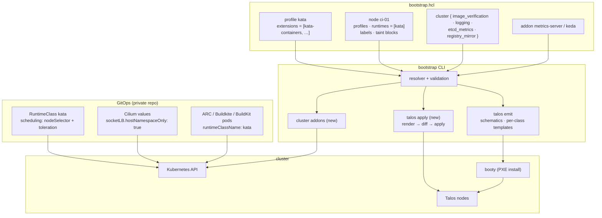
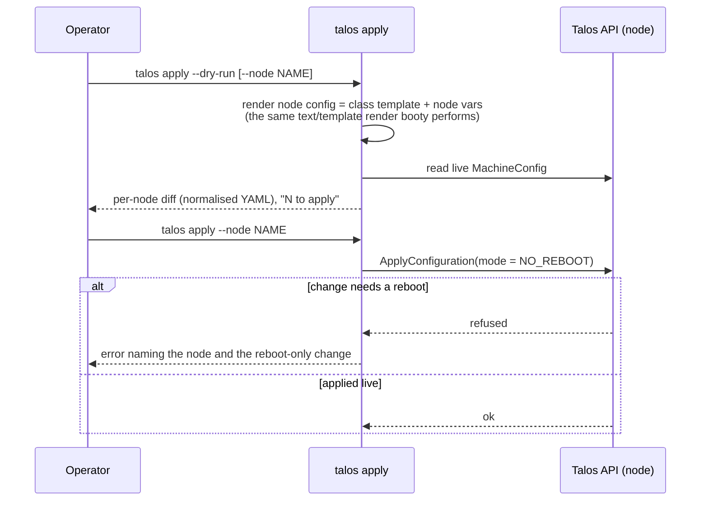
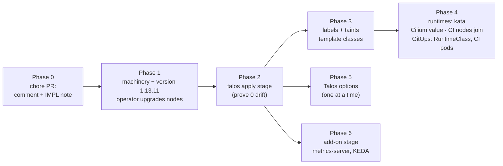

<!-- markdownlint-disable-file MD025 MD041 -->

# DESIGN-0005: Talos 1.13.11 upgrade with Kata CI isolation and cluster options

<!--toc:start-->
- [Overview](#overview)
- [Goals and Non-Goals](#goals-and-non-goals)
  - [Goals](#goals)
  - [Non-Goals](#non-goals)
- [Background](#background)
  - [Where the cluster is today](#where-the-cluster-is-today)
  - [Facts that shape the design](#facts-that-shape-the-design)
- [Detailed Design](#detailed-design)
  - [How the pieces fit](#how-the-pieces-fit)
  - [Phase 0 — correct the setInterfaces record](#phase-0--correct-the-setinterfaces-record)
  - [Phase 1 — Talos 1.13.11](#phase-1--talos-11311)
  - [Phase 2 — day-2 apply stage](#phase-2--day-2-apply-stage)
  - [Phase 3 — node labels and taints](#phase-3--node-labels-and-taints)
  - [Phase 4 — runtimes: Kata for CI](#phase-4--runtimes-kata-for-ci)
  - [Phase 5 — Talos-side options](#phase-5--talos-side-options)
  - [Phase 6 — cluster add-on options](#phase-6--cluster-add-on-options)
- [API / Interface Changes](#api--interface-changes)
- [Data Model](#data-model)
- [Testing Strategy](#testing-strategy)
- [Migration / Rollout Plan](#migration--rollout-plan)
- [Open Questions](#open-questions)
- [References](#references)
<!--toc:end-->

## Overview

Following INV-0004, this design keeps the cluster on Talos 1.13 and
does four things:

- upgrades it to the last 1.13 patch, **v1.13.11**;
- corrects a wrong rationale in the record;
- adds the first workload-isolation tier — **Kata Containers on
  tainted CI worker nodes**, with runc staying the default everywhere
  else;
- turns the useful Sidero guides into **opt-in HCL options**.

The options are: image signature verification, Talos log shipping,
the etcd metrics endpoint, a pull-through registry mirror,
metrics-server, and KEDA.

The options are off unless declared. The intent is that a first
bootstrap sets none of them, an operator turns them on in
`bootstrap.hcl` to test, and later the hoomlab / platformctl service
enables them itself after its first bootstrap. The 1.14 move is
DESIGN-0006's job. Everything here is built so that only the renderer
changes when it lands.

## Goals and Non-Goals

### Goals

- **G1** — Phase 0 chore PR: fix the `setInterfaces` comment and the
  IMPL-0003 Phase 2 note (the network documents *do* exist in 1.13
  machinery).
- **G2** — Talos v1.13.11 and machinery v1.13.11, with a runbook for
  the in-place node upgrades.
- **G3** — a delivery path for day-2 options to **live** nodes. Today
  the CLI only feeds booty templates, which a node reads once, at
  install.
- **G4** — per-node scheduling primitives: node labels and taints,
  validated at load against what Kubernetes will actually accept.
- **G5** — per-node runtime declaration, Kata first. Validation ties a
  runtime to its extension and to the Cilium values it needs.
- **G6** — opt-in Talos-side options: image verification, logging,
  etcd metrics, registry mirror.
- **G7** — opt-in cluster add-ons: metrics-server and KEDA, with a
  documented Temporal scaler pattern.

### Non-Goals

- **Changing the default runtime.** runc is Talos's containerd
  default and stays the only default. A node never runs everything
  under Kata. Pods opt in with `runtimeClassName`. Making a sandbox
  runtime a node's default would push Cilium, the CSI node plugin,
  and every `hostNetwork` DaemonSet into a VM or netstack they can't
  run in.
- **gVisor, crun, NVIDIA.** All three are deferred. The runtime
  surface (Phase 4) is shaped to accept them later as a resolver-only
  change. gVisor also needs the `user.max_user_namespaces` sysctl. crun
  is a runc alternative with little isolation value. NVIDIA needs GPU
  PCI passthrough, which the `pve vms` stage doesn't model.
- **Talos workload isolation (`sandboxd`).** It is 1.14-only; see
  DESIGN-0006.
- **RuntimeClass objects, CI runner config, `ScaledObject`s.** These
  are workload-side and live in GitOps. This design states the
  contract they rely on (OQ-9, OQ-19).
- **Proxmox HA and load-balancer policy for Kata VMs.** It's
  documented as an operator constraint; nothing here automates it.

## Background

### Where the cluster is today

| Fact | Value |
| ---- | ----- |
| Talos / Kubernetes | v1.13.8 / v1.36.3 |
| Default runtime | runc, everywhere; no RuntimeClasses |
| CI | ARC runners, BuildKit, Buildkite. The first two run in `privileged` Pod Security namespaces and Buildkite in `baseline`, all under runc. |
| Nested virtualisation | Guests see `vmx`, because bootstrap creates VMs with `cpu = host`. `/dev/kvm`, `/dev/vhost-vsock`, and `/dev/vhost-net` already exist on workers. |
| Cilium | v1.20.1, KPR. `bpf-lb-sock-hostns-only = true` live, **forced by `gatewayAPI.enabled`**, not set in the values file. Bandwidth manager off. |
| Bootstrap delivery | `talos emit` renders per-role templates that booty serves at PXE install. Live nodes are changed by hand-run `talosctl patch` (IMPL-0003, the install-image patch). |

### Facts that shape the design

Confirmed against the v1.13.11 sources and docs (INV-0004 plus a
follow-up check):

- **Workers can't set their own taints.** Talos applies
  `machine.nodeLabels` and `machine.nodeTaints` live by updating the
  Node with the **kubelet's** credentials on workers. NodeRestriction
  forbids kubelets from modifying taints, so `machine.nodeTaints`
  fails on workers and retries every ~12s (talos#13443,
  discussion #9895). The supported path is the kubelet's
  `registerWithTaints` (`machine.kubelet.extraConfig`), which applies
  **at registration only**.
- **Workers can't use restricted label prefixes.** NodeRestriction
  rejects `node-role.kubernetes.io/*` and
  `node-restriction.kubernetes.io/*`. Talos only checks syntax, so a
  bad key surfaces as a runtime retry loop, not a config error.
- **Kata on Talos 1.13.11** is the `siderolabs/kata-containers`
  extension (Kata 3.32.0, "extra" tier). It has **one handler, `kata`**
  — Cloud Hypervisor, virtio-fs, `tcfilter` networking. There is no
  `kata-qemu`. It needs no machine config: KVM, vhost-net,
  vhost-vsock, and virtio-fs are built into the Talos kernel. Its
  README RuntimeClass declares `overhead.podFixed` of 130Mi / 250m.
  The sandbox default is 1 vCPU and 2048 MiB of guest memory.
- **Cilium + Kata.** Socket LB can't hook inside a guest kernel, so
  `socketLB.hostNamespaceOnly: true` is required (Cilium
  kube-proxy-free docs). talos#13745: Kata pods lose ingress with
  Cilium's bandwidth manager plus packet timestamping. cilium#48420
  (open, Talos 1.13.9 + Cilium 1.20.1): after a reboot, socket-LB
  cgroup links can pin to a dying cgroup, breaking host-netns
  ClusterIP access.
- **RuntimeClass `scheduling`.** `nodeSelector` is intersected with
  the pod's (a conflict means the pod is rejected) and `tolerations`
  are unioned. A CI pod then needs only `runtimeClassName: kata`;
  placement and toleration come from the class.
- **The 1.13 config documents.** `ImageVerificationConfig` (1.13.0+)
  has rules `image` / `skip` / `deny` / `keyless{issuer, subject |
  subjectRegex}` / `publicKey{certificate}`, exactly one action per
  rule, and first match wins. **An unmatched image is allowed.**
  `RegistryMirrorConfig` / `RegistryAuthConfig` / `RegistryTLSConfig`
  have existed since 1.12; `machine.registries` is deprecated.
  `KmsgLogConfig` is a document. `machine.logging`, `nodeLabels`,
  `nodeTaints`, `sysctls`, and `kernel.modules` are still `v1alpha1`.
- **The ownership boundary** (DESIGN-0002): "If it must be decided at
  image-build time or machine-config time, bootstrap owns it. If it is
  expressible as a Kubernetes API object on a running cluster, the IaC
  layer owns it." OQ-D put metrics-server in GitOps. Phase 6
  deliberately revisits that (OQ-18).

## Detailed Design

### How the pieces fit



The CLI owns what is decided at image-build or machine-config time:
extensions, labels, registration taints, and Talos options. GitOps
owns the Kubernetes objects: RuntimeClasses, the CI pod specs, and
Cilium's ongoing values. The contract between the two is a set of
**label and taint keys** and **a Cilium value**, written down below so
both sides can be checked.

### Phase 0 — correct the setInterfaces record

This is a separate chore PR with no behaviour change.

- `tools/bootstrap/internal/talos/machineconfig.go`. Rewrite the
  `setInterfaces` doc comment and its `nolint:staticcheck` reason. The
  current text says "machinery v1.13 ships no multi-doc network device
  type", which is false: `LinkAliasConfig`, `LinkConfig`, and
  `DHCPv4Config` exist in v1.13.9. The true reasons the legacy section
  stays:
  - it is the exact shape the live fleet carries;
  - deprecated fields and their documents are mutually exclusive, so
    switching is a whole-config replacement on every node;
  - that migration belongs to DESIGN-0006.
- `docs/impl/0003-talos-storage-plane.md` Phase 2 note. Add a dated
  correction with the same facts. The record is amended, not
  rewritten.
- PR label `dont-release`. It touches only a comment and a doc, so
  the tools release doesn't need to cut.

### Phase 1 — Talos 1.13.11

- **CLI:** bump `github.com/siderolabs/talos/pkg/machinery` to
  v1.13.11 (the tag exists). Update `emit_test.go`'s `talosVersion`,
  the example `talos.version`, and the README/runbook references.
  Machinery's default Kubernetes is still 1.36.3, so leaving
  `kubernetes_version` unset changes nothing.
- **What 1.13.9–1.13.11 change that we touch:**
  - stricter hostname validation (1.13.11) — node names like `work01`
    are plain DNS labels, but add a load-time test case;
  - image-reference normalisation before verification rules match
    (1.13.10) — Phase 5 relies on it;
  - `talosctl time --check` removed from `os:reader` — no impact.
- **Operator runbook.** These are hands-on steps the operator runs;
  the CLI only renders the new version.
  1. Set `talos.version = "v1.13.11"` and run `talos emit --dry-run`.
     It should show the template and catalog changes plus new boot
     assets, and nothing else.
  2. Run `talos emit` and `talos ipxe`, then restart booty. This only
     affects future installs.
  3. For each node — workers first, then control planes one at a
     time — run `talosctl upgrade --nodes <ip> --image
     factory.talos.dev/installer/<schematic>:v1.13.11`, then
     `talosctl health`.
  4. After each reboot, check for cilium#48420:
     `bpftool cgroup show /sys/fs/cgroup effective` from a host-netns
     debug pod, plus a ClusterIP curl from host-network.
  5. Optional: `talosctl upgrade-k8s --to 1.36.5` (OQ-2).
- `talosctl upgrade --image` rewrites the stored `install.image`, so
  this upgrade also retires the drift class the install-image patch
  fixed by hand.

### Phase 2 — day-2 apply stage

Every option below is a machine-config change, and today nothing
delivers config to a running node. A new stage closes that gap.

```text
talos secrets → talos emit → talos ipxe → [booty] → talos vms → talos bootstrap → talos health → talos apply (new, opt-in)
```



- **Step semantics.** The stage uses the existing stateless `Step`
  engine.
  - `Check` renders the node's config and compares it, normalised,
    with the live one.
  - `Apply` sends it with `NO_REBOOT`. It never reboots: 1.14 removes
    reboot mode anyway, and reboots stay the operator's call.
  - A re-run after success applies nothing.
- **Scope.** The stage is opt-in and explicit. It runs only when
  invoked, never as part of the bootstrap chain, and `--node` scopes
  it to one node. It reads `out/talosconfig`, which is never
  overwritten.
- **Normalisation.** Decode both sides through machinery's config
  loader and re-encode, so formatting and comment differences don't
  count as drift. A semantic diff is printed in `--dry-run`.
- **What it can't do.** Schematic changes (new extensions) are image
  changes, not config. The stage detects a mismatch between the node's
  rendered `install.image` and the running schematic (`get extensions`)
  and tells the operator to `talosctl upgrade --image`. It doesn't
  re-image.
- **Live drift.** The fleet was hand-patched twice (the storage plane
  and `install.image`), and both were reconciled into the templates
  (emit Check reports clean). The first `--dry-run` across all 8 nodes
  is the proof that render and live agree. Any diff found there is
  investigated before anything is applied.

This is OQ-12; the options in Phases 5 and 6 are only useful live if
it lands.

### Phase 3 — node labels and taints

**HCL surface.** Per node, two primitives:

```hcl
node "ci-01" {
  role     = "worker"
  # …
  labels = {
    "hoomlab.io/workload" = "ci"
  }
  taint "hoomlab.io/workload" {
    value  = "ci"
    effect = "NoSchedule"   # NoSchedule | PreferNoSchedule | NoExecute
  }
}
```

**Optional sugar** (OQ-5) — a workload class sets the label and taint
pair in one line:

```hcl
node "ci-01" {
  workload_class = "ci"   # ⇒ label + taint hoomlab.io/workload=ci:NoSchedule
}
```

The sugar and an explicit label or taint on the same key is an
**error**, never an override (XOR, as in DESIGN-0004).

**Rendering.**

- Labels go to `machine.nodeLabels`, merged with the completion
  labels (region, zone, exclude-from-LB).
- Taints go to **`machine.kubelet.extraConfig.registerWithTaints`**,
  never `machine.nodeTaints`. On workers, `nodeTaints` fails against
  NodeRestriction; the kubelet's registration taints don't.
- Consequence: **taints apply when a node registers.** That is right
  for new nodes, which is how the CI pool is built (OQ-11). Changing
  taints on an already-registered node needs a Node-object change.
  The apply stage reports it as drift and prints the exact
  `kubectl taint` command. The operator runs it (OQ-4).

**Validation (new rules, all at load).**

- Label keys and values must be Kubernetes qualified names. The
  prefix must be a DNS subdomain.
- Restricted prefixes are rejected: `node-role.kubernetes.io/` and
  `node-restriction.kubernetes.io/`. Any other `kubernetes.io/` or
  `k8s.io/` prefix outside the NodeRestriction allow-list
  (`node.kubernetes.io/`, `kubelet.kubernetes.io/`,
  `topology.kubernetes.io/`, …) is also rejected. The error names the
  admission plugin, so it isn't discovered as a 12-second retry loop
  on the node.
- A label key that collides with a completion label (region, zone,
  exclude-from-LB) is an error.
- Taint `effect` must be one of the three values. Duplicate
  `key:effect` pairs are an error.

**Template classes.** Today there is one template per role.
DESIGN-0004's role-uniformity rule exists because booty profiles
"split a role only by vars and boot paths, never by template". Labels
and taints are maps, not scalar vars, so they can't ride the textual
var substitution.

- Emit therefore keys templates by **(role, scheduling set)**, where
  the scheduling set is the node's labels, taints, and runtimes.
- Booty profiles already name their template per profile, so the
  catalog supports this unchanged. The profile key becomes (role,
  schematic, scheduling set).
- Class names are derived deterministically (role, then schematic
  short ID, then a short scheduling-set hash) only when a role
  actually splits, mirroring how schematics split classes today.
  Single-class roles keep their current names, so **the live
  8-node tree stays byte-identical** until a node declares labels or
  taints.
- Interface-shape uniformity stays a per-role rule.

### Phase 4 — runtimes: Kata for CI

**HCL surface.** Per node:

```hcl
profile "kata" {
  extensions = [
    "siderolabs/qemu-guest-agent",
    "siderolabs/iscsi-tools",        # CSI volumes still mount on these nodes
    "siderolabs/kata-containers",
  ]
}

node "ci-01" {
  role           = "worker"
  profiles       = ["kata"]
  runtimes       = ["kata"]          # declares what this node can run beyond runc
  workload_class = "ci"
  # …
}
```

**Runtime table in code.** A closed set (OQ-3). Adding a runtime is
one table row plus its rules:

| Runtime | Extension | Handler | Node requirements |
| ------- | --------- | ------- | ----------------- |
| `kata` | `siderolabs/kata-containers` | `kata` | worker, `/dev/kvm` (guaranteed by `cpu = host` and host nested virt) |
| `gvisor` *(deferred)* | `siderolabs/gvisor` | `runsc` | sysctl `user.max_user_namespaces` |
| `crun` *(deferred)* | `siderolabs/crun` | `crun` | — |
| `nvidia` *(deferred)* | `nvidia-open-gpu-kernel-modules-*` + `nvidia-container-toolkit-*` | `nvidia` | GPU PCI passthrough (no `pve vms` support), kernel modules |

**Validation.**

- A declared runtime's extension must be in the node's flattened
  profiles. The CLI doesn't add it: the profile is the
  image-build-time decision and stays explicit.
- An extension present without the runtime declared is allowed. A
  node can carry a runtime binary it doesn't advertise.
- Runtimes are worker-only.
- **Cilium cross-check:** if any node declares `kata`, the validated
  Cilium values must set `socketLB.hostNamespaceOnly: true`
  explicitly. Gateway API forcing it today is an implementation detail
  of Cilium 1.20, and the requirement must survive a values change. If
  `bandwidthManager.enabled` is true, emit an error (talos#13745).
  This sits beside the existing KPR and KubePrism invariants in
  `ciliumvalues.go`.

**Derived label.** OQ-7: `runtimes = ["kata"]` derives the label
`runtime.hoomlab.io/kata = "true"`. It is the key the RuntimeClass
selects on, so the RuntimeClass never depends on a hand-maintained
label. An explicit label with the same key is an XOR error.

**The GitOps contract.** The RuntimeClass is written in the private
repo (OQ-9), shown here as the contract:

```yaml
apiVersion: node.k8s.io/v1
kind: RuntimeClass
metadata:
  name: kata
handler: kata
overhead:
  podFixed:
    memory: 130Mi
    cpu: 250m
scheduling:
  nodeSelector:
    runtime.hoomlab.io/kata: "true"
  tolerations:
    - key: hoomlab.io/workload
      operator: Equal
      value: ci
      effect: NoSchedule
```

A CI pod sets only `runtimeClassName: kata`. It lands on a Kata node
and tolerates the CI taint. Nothing else can schedule there.

**CI pod shape** (GitOps, informative):

- ARC runner and Buildkite job pods move to `runtimeClassName: kata`.
- Privileged DinD or BuildKit is fine *inside* the guest, but the
  namespaces stay `privileged` at the Pod Security level, because PSA
  evaluates the pod spec, not the boundary.
- `/var/lib/docker` (or BuildKit's state) goes on an `emptyDir`
  (`medium: Memory`) or a loop-mounted ext4 image. virtio-fs can't be
  an overlayfs upper layer.
- For Buildkite, enable `prohibit-kubernetes-plugin` so pipelines
  can't strip the RuntimeClass.

**Sizing (operator).** Budget per CI pod: its requests, plus
130Mi / 250m overhead, plus guest-kernel memory. The Cloud Hypervisor
default guest is 2048 MiB and is touched lazily
**[unverified actual RSS]**. Kata VMs can't live-migrate with nesting
active, so pin them out of PVE HA and the 9.2 load balancer.

### Phase 5 — Talos-side options

These are off unless declared. They live inside the existing
`talos.cluster` block, which is already the completion surface (OQ-13).
Each one is a machine-config change, delivered at install by emit and
to live nodes by `talos apply`.

**Image signature verification** → `ImageVerificationConfig`.

```hcl
cluster {
  image_verification {
    rule {
      image = "ghcr.io/siderolabs/*"
      keyless {
        issuer        = "https://accounts.google.com"
        subject_regex = "(@siderolabs\\.com$|^releasemgr-svc@talos-production\\.iam\\.gserviceaccount\\.com$)"
      }
    }
    rule {
      image = "factory.talos.dev/*"
      keyless {
        issuer  = "https://accounts.google.com"
        subject = "image-factory-signing@talos-production.iam.gserviceaccount.com"
      }
    }
    rule {
      image = "*"
      skip  = true        # explicit terminal rule — required (see validation)
    }
  }
}
```

- Validation:
  - exactly one action per rule (`skip`, `deny`, `keyless`,
    `public_key`);
  - `keyless` needs `issuer` plus exactly one of `subject` and
    `subject_regex`;
  - `public_key { certificate = "path.pem" }` is resolved relative to
    the config and read at load;
  - **the last rule must be `image = "*"`** with `skip` or `deny`.
    Talos's implicit "unmatched is allowed" becomes a visible
    decision, not a hidden default.
- Caution: verifying `registry.k8s.io/*` broke etcd startup on
  1.13.2 (talos#13342). The initial policy (OQ-17) leaves it out
  until tested on one node.

**Logging** → `machine.logging.destinations` and `KmsgLogConfig`.

```hcl
cluster {
  logging {
    destination {
      endpoint = "tcp://192.0.2.10:6051/"
      format   = "json_lines"     # required; the only format Talos has
    }
    kernel "kmsg" {
      url = "tcp://192.0.2.10:6052/"
    }
  }
}
```

The receiver is Alloy, already deployed by GitOps. How it is reached
is OQ-15. Pod logs stay with Alloy's own collection.

**etcd metrics** → `cluster.etcd.extraArgs.listen-metrics-urls`
(control-plane template only).

```hcl
cluster {
  etcd_metrics {
    listen_url = "http://0.0.0.0:2381"
  }
}
```

- Plain HTTP on its own port. It survives 1.14's move of the default
  metrics endpoint to 2383. kube-prometheus-stack's `kubeEtcd` scrape
  is configured in GitOps.
- The node IP isn't known at render time (the primary is DHCP), so
  binding to a specific IP isn't expressible without a new per-node
  var (OQ-14).
- The docs say "after the node reboots". Whether an etcd restart is
  enough is **[unverified]**, so the apply stage reports it and the
  operator reboots control planes one at a time.

**Registry mirror** → `RegistryMirrorConfig`, the document form.
It is 1.14-ready and avoids the deprecated `machine.registries`.

```hcl
cluster {
  registry_mirror "docker.io" {
    endpoints     = ["https://192.0.2.20:5000"]
    skip_fallback = false        # required: fall back to upstream when the mirror fails?
    override_path = false        # Harbor-style path rewriting
  }
  registry_mirror "ghcr.io" {
    endpoints     = ["https://192.0.2.20:5000"]
    skip_fallback = false
    override_path = false
  }
}
```

- Auth (`RegistryAuthConfig`) and a private CA (`RegistryTLSConfig`)
  are left out of the first cut. Credentials would need the
  `env("HOOMLAB_…")` reference pattern, so they are added only when
  the mirror needs them.
- Where the mirror runs is OQ-16. Off-cluster is preferred, so the
  cluster can pull during its own recovery.

### Phase 6 — cluster add-on options

metrics-server and KEDA are Kubernetes objects, not machine config,
so DESIGN-0002's boundary puts them in GitOps. The case for an
opt-in bootstrap surface anyway: the platformctl self-bootstrap story
needs *something* to stand them up after T2, and testing a feature
should not depend on the private repo. The recommended form (OQ-18)
is a **separate, explicit post-T2 stage**, not machine config:

```hcl
addon "metrics-server" {
  version = "v0.9.0"
}
addon "keda" {
  version = "v2.21.0"
}
```

- `cluster addons` is a new stage after `talos health` and is opt-in.
  `Check` asks whether the add-on is present at the pinned version
  (Deployment image tag). `Apply` server-side-applies the pinned
  upstream release manifest, with field manager `hoomlab-bootstrap`.
  KEDA's CRDs exceed the client-side-apply annotation limit, and
  server-side apply also makes later GitOps adoption visible.
- The add-on set is closed in code (name → pinned manifest URL
  template), like the cert-approver pin.
- **Declaring an add-on that GitOps already owns is an
  operator error.** The design can't detect it. The field manager
  makes the conflict visible on the first GitOps sync.
- metrics-server's prerequisite (signed kubelet serving certs) is
  already met: `rotate-server-certificates` plus cert-approver, so
  there is no `--kubelet-insecure-tls`.

**KEDA's Temporal scaler** is a per-workload `ScaledObject` that lives
next to the Temporal worker Deployment in GitOps (OQ-19). The pattern,
for reference:

```yaml
apiVersion: keda.sh/v1alpha1
kind: ScaledObject
metadata:
  name: temporal-worker
spec:
  scaleTargetRef:
    name: temporal-worker
  minReplicaCount: 1          # scale-to-zero can kill in-flight work (keda#7368)
  maxReplicaCount: 10
  triggers:
    - type: temporal
      metadata:
        endpoint: temporal-frontend.temporal.svc:7233
        namespace: default
        taskQueue: build-jobs
        targetQueueSize: "5"
        queueTypes: workflow,activity
```

KEDA serves `external.metrics.k8s.io` itself. metrics-server is only
needed for CPU or memory triggers.

## API / Interface Changes

HCL additions, all optional, with nothing changing for configs that
don't use them:

| Where | Addition | Phase |
| ----- | -------- | ----- |
| `node` | `labels` map, `taint "<key>" { value, effect }` blocks, `workload_class` (sugar), `runtimes` list | 3, 4 |
| `talos.cluster` | `image_verification { rule { … } }`, `logging { destination {…} kernel "<name>" {…} }`, `etcd_metrics { listen_url }`, `registry_mirror "<registry>" { … }` | 5 |
| top level (`talos`) | `addon "<name>" { version }` | 6 |

CLI additions:

- `bootstrap talos apply [--dry-run] [--node NAME]` (Phase 2).
- `bootstrap cluster addons [--dry-run]` (Phase 6).

Neither runs as part of the default bootstrap chain.

Emit changes: templates key on (role, scheduling set). Single-class
roles keep today's names and bytes.

## Data Model

```text
TalosNode (raw HCL)                      ResolvedNode (consumers read this)
  Labels        map[string]string   ──►    Labels   map[string]string   (explicit ∪ derived; collisions = error)
  Taints        []Taint             ──►    Taints   []Taint             (explicit ∪ workload_class)
  WorkloadClass string              ──►    (consumed by the resolver)
  Runtimes      []string            ──►    Runtimes []Runtime           (table rows: handler, extension, rules)
TalosCluster
  ImageVerification *ImageVerification   (rules, ordered)
  Logging           *Logging
  EtcdMetrics       *EtcdMetrics
  RegistryMirrors   []RegistryMirror
Talos
  Addons            []Addon              (name, version)
```

This keeps the DESIGN-0004 pattern: raw input → resolver → a
fully-explicit resolved form, so renderers never know whether a label
came from `labels`, `workload_class`, or `runtimes`. That is also what
makes the 1.14 renderer swap (DESIGN-0006) a renderer-only change.

No new persisted state. `secrets.yaml`, `talosconfig`, and
`kubeconfig` are untouched.

## Testing Strategy

- **Config:**
  - table tests for every new validation rule (restricted prefixes,
    XOR collisions, the runtime-extension pairing, the Cilium
    `hostNamespaceOnly` and bandwidth-manager checks, terminal `*`
    rule, keyless subject XOR, add-on name set, 1.13.11 hostnames);
  - positive controls for each.
- **Emit:**
  - golden templates for a split worker role (base + kata/ci class);
  - a test that a config without the new attributes stays
    byte-identical to today's output;
  - machinery `Validate` (metal mode) passes on every class template.
- **Apply stage:**
  - unit tests with a fake Talos client (render, normalise, diff,
    `NO_REBOOT`, refusal path, schematic-mismatch message);
  - live: `--dry-run` across the 8 nodes must report 0 to apply
    before any option is enabled.
- **Live Kata acceptance**, on the first CI node:
  - `uname -r` in a `runtimeClassName: kata` pod differs from the
    host;
  - kube-dns and a ClusterIP resolve from inside the pod
    (`hostNamespaceOnly`);
  - a democratic-csi PVC mounts in a Kata pod (virtio-fs path);
  - privileged DinD builds an image;
  - a non-CI pod is refused by the taint;
  - the cilium#48420 check after a reboot.
- **Options:** each one enabled on one node first (one control plane
  for etcd metrics), verified (`talosctl image ls` for
  `talos.dev/verified`, received log lines, `curl :2381/metrics`, a
  pull through the mirror), then rolled out.

## Migration / Rollout Plan



- Each phase is its own PR, labelled `dont-release` until the tools
  release is wanted. Phases 5 and 6 are independent of 3 and 4 once
  Phase 2 exists.
- **Phase 4 live order:**
  1. Add `socketLB.hostNamespaceOnly: true` explicitly to the Cilium
     values in **both** the drill values file and GitOps. It is
     already in effect, so this is a no-op restart.
  2. Add the `kata` profile and new CI node blocks; run `pve vms` and
     PXE install. The nodes register with their taint.
  3. Run the acceptance checks above.
  4. GitOps adds the RuntimeClass.
  5. Move one CI workload (one ARC scale set), then the rest.
- **Rollback.** Remove `runtimeClassName` from the CI pods and they
  return to runc on regular workers. The Kata nodes can be drained and
  destroyed. Options are removed by deleting the block and running
  `talos apply`.

## Open Questions

Each question offers lettered options: **a** is the recommendation
and the others are alternatives. Answer with a letter or write your
own.

1. **Phase 0 scope.**
   - a. Comment and IMPL-0003 note only, as a standalone chore PR.
   - b. Also migrate `setInterfaces` to `LinkAliasConfig` / `LinkConfig`
     / `DHCPv4Config` now, on 1.13.
   - c. Fold it into the Phase 1 PR.
2. **Kubernetes patch with the 1.13.11 upgrade.**
   - a. Yes: `upgrade-k8s` to 1.36.5 after all nodes are on 1.13.11,
     and pin `kubernetes_version = "1.36.5"` in HCL.
   - b. Talos only; stay on 1.36.3 (machinery's default).
3. **Which runtimes the schema accepts now.**
   - a. `kata` only; anything else is a load error naming the
     supported set. gVisor, crun, and NVIDIA are added as table rows
     when designed.
   - b. Accept `kata` and `gvisor` (gVisor's extra rule is just the
     userns sysctl).
   - c. Reserve all four names; unimplemented ones error as "not yet
     supported".
4. **Taints on already-registered nodes.**
   - a. `registerWithTaints` for new nodes. The apply stage reports
     taint drift on existing nodes and prints the `kubectl taint`
     command for the operator.
   - b. The apply stage also patches Node taints itself via
     `kubeconfig`, crossing into the Kubernetes API.
   - c. Taints only at registration; changing one means re-registering
     the node (delete the Node, restart the kubelet).
5. **Workload-class sugar.**
   - a. `workload_class = "ci"` derives label + taint
     `hoomlab.io/workload=ci:NoSchedule`, XOR with explicit keys.
   - b. No sugar; always write `labels` + `taint` explicitly.
   - c. The runtime implies the taint (Kata nodes auto-tainted `ci`).
6. **Label and taint key prefix.**
   - a. `hoomlab.io/`. Kubernetes only requires DNS-subdomain form,
     and it names the project.
   - b. A domain you own.
   - c. Unprefixed keys (`workload`), which collide more easily with
     third-party labels.
7. **Derived runtime label.**
   - a. `runtimes = ["kata"]` derives `runtime.hoomlab.io/kata=true`
     for the RuntimeClass `nodeSelector`.
   - b. No derivation; the operator writes the label the RuntimeClass
     selects on.
8. **Cilium `socketLB.hostNamespaceOnly` rule.**
   - a. Required explicitly in the values when any node declares a
     sandbox runtime; error otherwise. Bandwidth manager with Kata is
     an error.
   - b. Required always, sandbox or not. It's in effect live anyway
     via Gateway API.
   - c. Warning only.
9. **Who owns the `kata` RuntimeClass object.**
   - a. GitOps, with the contract above written here.
   - b. Bootstrap, via `extraManifests` / inline manifest at day 0.
   - c. Bootstrap's Phase 6 add-on stage (`addon "runtimeclasses"`).
10. **Kata VM handler.** Resolved by research: Talos 1.13.11 ships
    only `kata` (Cloud Hypervisor). Revisit if `kata-qemu` ever
    appears. *No decision needed — listed so the numbering stays
    stable.*
11. **How Kata CI nodes are provisioned.**
    - a. New dedicated worker VMs (a CI pool) from bootstrap. They
      register tainted, so no `kubectl taint` is needed, and are
      sized for the Kata overhead.
    - b. Convert existing workers (`talosctl upgrade --image` to the
      kata schematic, plus a manual taint).
    - c. Start with one converted worker for the spike, then a new
      pool.
12. **Day-2 delivery to live nodes.**
    - a. A new `talos apply` stage (render → diff → `NO_REBOOT`
      apply).
    - b. Emit per-node patch files; the operator runs `talosctl
      patch`.
    - c. Templates only; live nodes get options at their next
      reinstall.
13. **Where the Talos-side options live in HCL.**
    - a. Inside `talos.cluster`, beside the CNI. It is already the
      completion surface.
    - b. A new `talos.options` block.
    - c. Top-level blocks.
14. **etcd metrics exposure.**
    - a. `listen-metrics-urls = http://0.0.0.0:2381`, plain HTTP on
      the control planes.
    - b. No Talos change; scrape 2379 with etcd client mTLS (client
      cert as a Secret in the monitoring namespace).
    - c. a, plus a Talos ingress firewall rule (`NetworkRuleConfig`)
      limiting 2381 to the pod CIDR.
15. **How Talos reaches the Alloy log receiver.**
    - a. A fixed LoadBalancer IP (Cilium LB IPAM) for an Alloy
      TCP/json_lines listener. Talos is configured with that IP.
    - b. A `hostNetwork` Alloy DaemonSet listener; Talos sends to
      `127.0.0.1`.
    - c. An off-cluster collector.

    Which Alloy component accepts Talos `json_lines` over TCP is
    **[unverified]**. Vector's `socket` source is the documented
    pattern.
16. **Where the pull-through mirror runs.**
    - a. Off-cluster (e.g. zot or `registry:2` in proxy mode on the
      booty host), so the cluster can pull during its own recovery.
    - b. In-cluster Harbor.
    - c. No mirror until CI pull volume demands it.
17. **Initial image-verification policy.**
    - a. Verify `ghcr.io/siderolabs/*` and `factory.talos.dev/*`
      keyless; terminal `*` skip. Add `registry.k8s.io/*` after a
      one-node test.
    - b. Also verify `registry.k8s.io/*` from the start.
    - c. Closed policy: terminal `*` deny with an explicit allow-list.
18. **metrics-server and KEDA delivery.** Amends DESIGN-0002 OQ-D.
    - a. The opt-in post-T2 `cluster addons` stage: server-side apply
      of pinned upstream manifests, off unless declared.
    - b. Talos `extraManifests` like cert-approver. That re-syncs on
      `upgrade-k8s` **[unverified]** and fights GitOps.
    - c. Keep both in GitOps; bootstrap documents the prerequisites
      only.
19. **KEDA Temporal scaler.**
    - a. A per-workload `ScaledObject` in GitOps, next to the worker
      Deployment, using the pattern documented here.
    - b. An HCL block that renders `ScaledObject`s from bootstrap.

## References

- [INV-0004: Talos 1.14 and Kubernetes 1.37 upgrade with workload isolation](../investigation/0004-talos-114-and-kubernetes-137-upgrade-with-workload-isolation.md)
- [DESIGN-0006: Talos 1.14 multi-document migration requirements](0006-talos-114-multi-document-migration-requirements.md)
- [DESIGN-0002: Talos cluster completion scope](0002-talos-cluster-completion-scope-for-bootstrap.md) — ownership boundary, OQ-D
- [DESIGN-0004: Network planes and interfaces](0004-network-planes-and-interfaces-for-the-bootstrap-cli.md) — XOR rule, resolver pattern
- [IMPL-0003: Talos storage plane](../impl/0003-talos-storage-plane.md)
- Talos v1.13.9 / v1.13.10 / v1.13.11 releases —
  <https://github.com/siderolabs/talos/releases/tag/v1.13.11>
- Talos 1.13 support matrix —
  <https://docs.siderolabs.com/talos/v1.13/getting-started/support-matrix>
- ImageVerificationConfig (1.13) —
  <https://docs.siderolabs.com/talos/v1.13/reference/configuration/security/imageverificationconfig>
- RegistryMirrorConfig (1.13) —
  <https://docs.siderolabs.com/talos/v1.13/reference/configuration/cri/registrymirrorconfig>
- Logging (1.13) —
  <https://docs.siderolabs.com/talos/v1.13/configure-your-talos-cluster/logging-and-telemetry/logging>
- KmsgLogConfig (1.13) —
  <https://docs.siderolabs.com/talos/v1.13/reference/configuration/runtime/kmsglogconfig>
- Node labels guide —
  <https://docs.siderolabs.com/kubernetes-guides/advanced-guides/node-labels>;
  talos#13443, discussion #9895
- NodeRestriction —
  <https://kubernetes.io/docs/reference/access-authn-authz/admission-controllers/#noderestriction>
- RuntimeClass scheduling —
  <https://kubernetes.io/docs/concepts/containers/runtime-class/#scheduling>
- Kata extension —
  <https://github.com/siderolabs/extensions/tree/v1.13.11/container-runtime/kata-containers>
- Cilium socket-LB bypass —
  <https://docs.cilium.io/en/v1.20/network/kubernetes/kubeproxy-free/#socket-loadbalancer-bypass-in-pod-namespace>;
  cilium#48420; talos#13745
- etcd metrics guide —
  <https://docs.siderolabs.com/kubernetes-guides/monitoring-and-observability/etcd-metrics>
- metrics-server — <https://github.com/kubernetes-sigs/metrics-server>
- KEDA Temporal scaler — <https://keda.sh/docs/2.21/scalers/temporal/>; keda#7368
- Buildkite agent-stack-k8s security —
  <https://buildkite.com/docs/agent/self-hosted/agent-stack-k8s/securing-the-stack>
- Kata docker how-to —
  <https://github.com/kata-containers/kata-containers/blob/main/docs/how-to/how-to-run-docker-with-kata.md>
