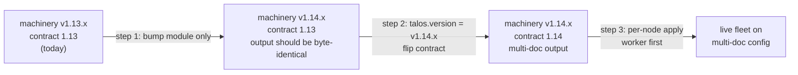
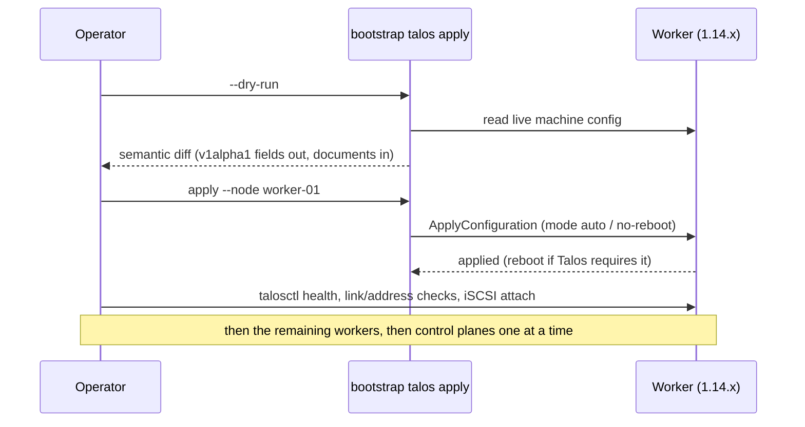
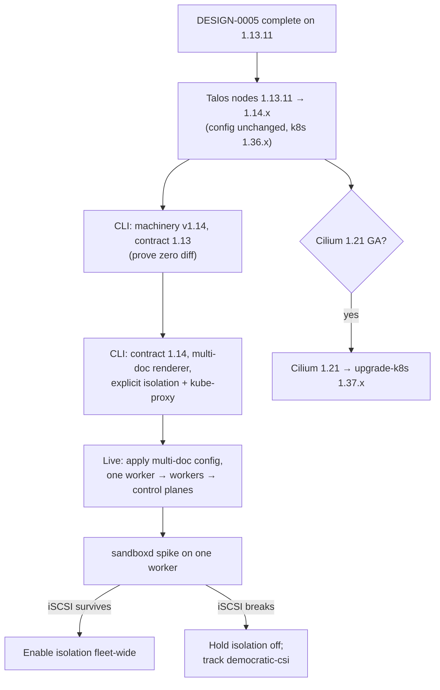

<!-- markdownlint-disable-file MD025 MD041 -->

# DESIGN-0006: Talos 1.14 multi-document migration requirements

<!--toc:start-->
- [Overview](#overview)
- [Goals and Non-Goals](#goals-and-non-goals)
  - [Goals](#goals)
  - [Non-Goals](#non-goals)
- [Background](#background)
- [Detailed Design](#detailed-design)
  - [Field inventory](#field-inventory)
  - [The version-contract lever](#the-version-contract-lever)
  - [Generation hazards](#generation-hazards)
  - [Template and catalog impact](#template-and-catalog-impact)
  - [Live rollout](#live-rollout)
  - [Workload isolation (sandboxd)](#workload-isolation-sandboxd)
  - [Cluster-level breaking changes](#cluster-level-breaking-changes)
  - [Kubernetes 1.37 gate](#kubernetes-137-gate)
  - [DESIGN-0005 surfaces under 1.14](#design-0005-surfaces-under-114)
  - [Deliberately skipped 1.14 features](#deliberately-skipped-114-features)
- [API / Interface Changes](#api--interface-changes)
- [Data Model](#data-model)
- [Testing Strategy](#testing-strategy)
- [Migration / Rollout Plan](#migration--rollout-plan)
- [Open Questions](#open-questions)
- [References](#references)
<!--toc:end-->

## Overview

Talos 1.14 splits most of the remaining `v1alpha1` machine config into
standalone documents, adds a `sandboxd` workload-isolation plane, and
carries several breaking changes. This document is the **requirements
holder** for moving the bootstrap CLI and the live cluster onto 1.14:
everything known today (INV-0004 plus a read of the CLI) about what
must change, in what order, and what is still unknown. It is expected
to evolve and to spawn narrower designs as each area is picked up — it
is not an implementation plan yet.

## Goals and Non-Goals

### Goals

- Inventory every machine-config field the CLI writes and its 1.14
  replacement document.
- Record the hazards where machinery 1.14's own defaults collide with
  the completion surface (DESIGN-0002).
- Name the migration lever (version contract) and a sequence that
  keeps every step reversible and byte-diff visible.
- Capture the cluster-level breaking changes and the Kubernetes 1.37
  gate so the upgrade isn't planned twice.
- Note how each DESIGN-0005 surface maps onto 1.14 so nothing built on
  1.13 has to be redesigned.

### Non-Goals

- Implementation phases and task lists — those come with an IMPL once
  the open questions below are decided.
- gVisor, crun, NVIDIA runtimes — DESIGN-0005 non-goals, revisited
  there.
- Talos 1.15 and the eventual **removal** of `v1alpha1` fields
  (no date published).

## Background

- [INV-0004](../investigation/0004-talos-114-and-kubernetes-137-upgrade-with-workload-isolation.md)
  concluded the 1.14 / 1.37 upgrade is in place, with no rebuild, and
  that deprecated `v1alpha1` fields keep working on 1.14 — so the CLI's
  1.13-shaped output stays valid on 1.14 nodes. The rework is
  deliberate, not forced.
- The upgrade guide is explicit on two rules that shape everything
  here: deprecated fields "remain supported", and **a deprecated field
  and its replacement document are mutually exclusive** — a config
  that sets both is rejected. No conversion tool exists.
- [DESIGN-0005](0005-talos-11311-upgrade-with-kata-ci-isolation-and-cluster-options.md)
  lands on 1.13.11 first and adds surfaces (labels/taints, runtimes,
  options, a day-2 apply stage) that this document must carry forward.

## Detailed Design

### Field inventory

Every `v1alpha1` field the CLI sets today (`internal/talos/`), plus
what DESIGN-0005 adds, against its 1.14 home:

| Field written today | Written by | 1.14 replacement | Notes |
| ------------------- | ---------- | ---------------- | ----- |
| `machine.install.image`, `.disk` (via `generate.WithInstallImage/Disk`) | `RoleTemplates` | `UnattendedInstallConfig` | Installer image is a templated var; the substitution target moves documents. Confirm `factory.talos.dev/installer/` vs `metal-installer/` for 1.14. |
| hostname | `setHostname` | `HostnameConfig` | Already a document today — no change. |
| `machine.nodeLabels` (region, zone, exclude-from-LB) | `applyCompletion` | `KubeNodeConfig` | Zone carries the hostname placeholder. DESIGN-0005 labels land here too. |
| `machine.kubelet.extraConfig.registerWithTaints` (DESIGN-0005) | new | `KubeletConfig` | Not `machine.nodeTaints` — NodeRestriction blocks kubelet-applied taints on workers; the restriction carries over to `KubeNodeConfig`. |
| `machine.kubelet.extraArgs.rotate-server-certificates` | `applyCompletion` | `KubeletConfig` | |
| `cluster.extraManifests` (Gateway API CRDs, cert-approver) | `applyCompletion` | `KubeExternalManifestConfig` (one per URL) | Ordering matters today (CRDs before Cilium) — confirm document ordering semantics **[unverified]**. |
| `cluster.inlineManifests` (cilium-values, cilium-bootstrap) | `applyCompletion` | `KubeInlineManifestConfig` | |
| `cluster.network.cni.name = none` | `applyCompletion` | `KubeNetworkConfig` | |
| `cluster.proxy.disabled = true` | `applyCompletion` | `KubeProxyConfig` | See hazard H2. |
| `machine.features.kubePrism` (read by `assertKubePrism`) | machinery default | `KubePrismConfig` | The invariant check must read the new document. |
| `machine.network.interfaces` (multi-NIC shapes) | `setInterfaces` | `LinkAliasConfig` + `LinkConfig` + `DHCPv4Config` | These documents already exist in 1.13 machinery (INV-0004 F5). |
| `machine.sysctls` (DESIGN-0005, if any) | new | `SysctlConfig` | |
| `RegistryMirrorConfig` (DESIGN-0005 option) | new | unchanged document | Exists since 1.12; DESIGN-0005 emits the document form, never the deprecated `machine.registries`. |
| `cluster.etcd.extraArgs.listen-metrics-urls` (DESIGN-0005 option) | new | none listed — stays `v1alpha1` | |
| `machine.logging.destinations` (DESIGN-0005 option) | new | none listed — stays `v1alpha1` | `KmsgLogConfig` is already a document. |
| `ImageVerificationConfig` (DESIGN-0005 option) | new | unchanged document | Introduced in 1.13.0. |
| cluster identity, PKI, endpoints (generated) | machinery `generate` | `KubeClusterConfig`, `KubeAPIServerConfig`, `KubeServiceAccountConfig`, CA documents, … | Produced by machinery itself under a 1.14 contract — not hand-written by the CLI. |

### The version-contract lever

`RoleTemplates` already derives the machinery contract from
`talos.version` (`ParseContractFromVersion` →
`generate.WithVersionContract`). That separates two changes the
upgrade would otherwise couple:

- **Step 1** proves the library bump in isolation: with the contract
  still 1.13, `talos emit --dry-run` against the live tree should
  report zero changes **[unverified — machinery may not preserve
  older-contract output byte for byte]**.
- **Step 2** is the real shape change, isolated to one variable.
- The live node upgrade (`talosctl upgrade` to 1.14.x) is independent
  of both: 1.14 nodes accept 1.13-shaped config.

### Generation hazards

Places where the 1.14 contract's defaults would silently change what
the cluster gets. Each must be explicit in the CLI (no hidden
defaults):

- **H1 — `SecurityProfileConfig`.** `gen config` for 1.14 emits
  `workloadIsolation: true` for new clusters **[unverified that
  `generate` does the same]**. Turning it on unannounced risks
  democratic-csi's iSCSI path (below). The CLI needs an explicit
  `workload_isolation` setting.
- **H2 — `KubeProxyConfig`.** A generated `KubeProxyConfig` defaults to
  enabled **[community report]**. Under Cilium kube-proxy replacement
  the CLI must emit it disabled, and the existing completion invariant
  (Cilium ⇒ kube-proxy off) must check the document, not the old
  field.
- **H3 — mutual exclusion.** Generated documents plus the CLI's
  completion edits must never produce a field and its document
  together. Completion code that appends to `v1alpha1` fields while
  `generate` emitted the document is an apply-time rejection. The
  completion surface moves **as a whole**, not field by field.
- **H4 — new defaults on new configs.** `FilesystemTrimConfig` on by
  default for new 1.14 configs, NRI enabled, ICMP `send_redirects=0`.
  Benign, but they show up in the emit diff and should be acknowledged
  rather than discovered.

### Template and catalog impact

- `templatize` is a textual swap of placeholder values for booty
  `{{ index .Vars "…" }}` expressions. It survives the move unchanged
  in principle — the placeholders just sit in different documents:
  the MAC placeholder moves into a `LinkAliasConfig` CEL selector
  string (`mac(link.permanent_addr) == "{{ … }}"`), the address
  placeholder into `LinkConfig.addresses`, the zone label into
  `KubeNodeConfig`, the install image into `UnattendedInstallConfig`.
- The "every expected placeholder must be present" guard keeps
  catching a placeholder that machinery re-encodes (e.g. quoting inside
  CEL).
- The DHCP gotcha: explicit link configuration **disables default DHCP
  on physical links**, so the primary interface needs its own
  `DHCPv4Config` even on single-NIC nodes once any link document is
  emitted. That breaks the "primary-only nodes emit no network
  section" byte-identity promise from DESIGN-0004 OQ-2 — decide
  whether it still holds (OQ-4).
- Link-alias change notification was fixed in 1.14.1 — the floor for
  emitting alias-based config is **v1.14.1**.

### Live rollout

Because old and new forms are mutually exclusive, a node can't be
moved with an additive patch. The rendered multi-doc config must
replace the node's config whole. DESIGN-0005's day-2 apply stage (if
adopted) is the natural mechanism: render each node's config from
template plus vars, diff it against the live config, and apply it.

- `apply-config --mode=reboot` is removed in 1.14. The stage must use
  `auto` / `no-reboot`, and where a reboot is needed the operator runs
  `talosctl reboot` explicitly (with drain).
- The network documents are the riskiest part: a wrong selector strands
  the node off-network. Use `--mode=try` (auto-rollback) for the first
  node if it is available for these documents **[unverified]**.

### Workload isolation (sandboxd)

- `SecurityProfileConfig.workloadIsolation: true` puts containerd, the
  kubelet, and every pod into a dedicated PID and mount namespace
  under `sandboxd`. Upgraded clusters stay non-isolated until the
  document is added.
- **Blocker to resolve:** democratic-csi's Talos mode uses
  `hostPID: true` plus `nsenter` into the host's `iscsiadm`/`iscsid`.
  Under `sandboxd`, the "host" PID namespace is the sandbox's. Whether
  iSCSI attach still works is unknown; Sidero only says CSI node
  plugins are unaffected in general.
- Known bug: CRI restart loop at boot, "sandbox namespace not
  available yet" (talos#14374). Reports conflict on whether enabling
  it needs a reboot.
- Required spike, on one worker: enable, then exercise PVC attach,
  detach, resize, pod reschedule, and node reboot, for both a runc and
  a Kata pod (DESIGN-0005).

### Cluster-level breaking changes

| Change | Requirement |
| ------ | ----------- |
| `ghcr.io/siderolabs/installer` no longer published | Already on Image Factory; verify the `installer/` path is served for 1.14 before the first upgrade. |
| `apply-config --mode=reboot` removed | Runbooks and the apply stage use `auto` / `no-reboot` plus an explicit `talosctl reboot`. |
| etcd `/metrics` + `/health` on **2383**, 2379 gRPC-only, etcd ≥ 3.6, TLS 1.3 minimum | DESIGN-0005's etcd-metrics option uses its own `listen-metrics-urls` port, so it survives. Anything added later that scrapes 2379 breaks. |
| FlexVolume host path removed | None (CSI only). |
| Upgrade path | Latest 1.13 patch (DESIGN-0005: v1.13.11) → latest 1.14 patch (v1.14.2 today), one node at a time. |
| `talosctl` client | Needs a 1.14 `talosctl` to read or emit the new document kinds; a 1.13 client rejects them. |

### Kubernetes 1.37 gate

- Talos 1.14 supports Kubernetes 1.33–1.37, so 1.14 can run 1.36.x
  indefinitely. Kubernetes moves separately with `talosctl
  upgrade-k8s`.
- **Gate:** Cilium 1.21 GA (1.20 is tested only up to Kubernetes
  1.36). Secondary: KEDA listing 1.37, democratic-csi with no 1.37
  regressions.
- 1.37 checks: SELinuxMount GA (Talos runs SELinux permissive — verify
  a CSI attach anyway); cAdvisor metrics `container_cpu_load_average_10s`
  and `container_tasks_state` removed (audit dashboards and alerts);
  no stable API removals.

### DESIGN-0005 surfaces under 1.14

| DESIGN-0005 surface | 1.13 form | 1.14 form |
| ------------------- | --------- | --------- |
| Node labels / taints | `machine.nodeLabels` / kubelet `registerWithTaints` | `KubeNodeConfig` / `KubeletConfig` |
| Runtimes (Kata) | extension in the schematic | unchanged; `CRICustomizationConfig` only if handler flags are ever needed |
| userns sysctl (gVisor, `hostUsers: false`) | `machine.sysctls` | `SysctlConfig` |
| Image verification | `ImageVerificationConfig` | unchanged |
| Logging | `machine.logging` + `KmsgLogConfig` | unchanged (no replacement listed) |
| etcd metrics | `cluster.etcd.extraArgs` | unchanged (no replacement listed); default endpoint moves to 2383 |
| Registry mirror | `RegistryMirrorConfig` | unchanged |
| Add-ons (metrics-server, KEDA) | per DESIGN-0005 OQ | if delivered as Talos manifests: `KubeExternalManifestConfig` |

The HCL surfaces DESIGN-0005 defines are version-agnostic. Only the
renderer changes, which is the point of the raw → resolved →
render split.

### Deliberately skipped 1.14 features

- **Image cache** (`ImageCacheConfig`) — needs ISO/USB/disk-image
  boot media; PXE isn't a documented carrier.
- **Native BGP** (`BGPInstanceConfig`) — Cilium BGP covers the
  workload prefixes; revisit for routed loopbacks, BFD, or ECMP to the
  fabric.
- **Dedicated system volumes, LVM, btrfs, MD RAID1** — single-disk
  VMs; nothing to gain yet.
- **DNS-over-TLS/HTTPS, NTS** — worth a look later, outside this
  migration.

## API / Interface Changes

Expected, pending the open questions:

- `talos { workload_isolation = true|false }` (or under `cluster`) —
  explicit, required once the contract is ≥ 1.14 (OQ-2).
- No other HCL change is required by 1.14 itself. The migration is a
  renderer change behind the existing schema.
- Changes to the emitted artifact tree: templates become multi-document
  YAML with more documents. Booty's overlay is format-agnostic text
  templating, so no booty change is expected **[unverified]**.

## Data Model

No new persisted state. The secrets bundle format is unchanged
across 1.13 → 1.14 **[unverified]**. `talosconfig` / `kubeconfig` are
untouched.

## Testing Strategy

- **Golden emit tests per contract** — the same fixture rendered under
  contract 1.13 and 1.14, asserting each hazard (H1–H3)
  explicitly: kube-proxy disabled, isolation as configured, no field
  and document pairs.
- **Machinery validation** stays the gate: every rendered config
  passes `provider.Validate` in metal mode.
- **Step-1 proof**: the module bump with the 1.13 contract reports
  zero emit changes against the live tree.
- **Live**: one worker through the apply sequence above, then the
  `sandboxd` spike, then the rest.

## Migration / Rollout Plan

Node upgrades (P1) and the Kubernetes bump (K) are independent of the
CLI work. P2–P4 are the CLI track. Each arrow is a stopping point
where the cluster is healthy and supported.

## Open Questions

Each question offers lettered options: **a** is the recommendation
and the others are alternatives. Answer with a letter or write your
own.

1. **Sequencing of the CLI move.**
   - a. Two releases: machinery bump with the contract held at 1.13
     (prove zero diff), then flip the contract as its own change.
   - b. One release: bump and flip together.
   - c. Stay on machinery 1.13 until a 1.14-only feature is needed.
2. **Workload isolation default once the contract is 1.14.**
   - a. Explicit required `workload_isolation` setting; the fleet stays
     `false` until the `sandboxd` spike passes.
   - b. Follow upstream: on for new clusters, off for upgraded ones,
     no knob.
   - c. Hard-code `false` with no knob until democratic-csi documents
     support.
3. **When to migrate `setInterfaces` to network documents.**
   - a. With the contract flip (P3), so each node's config shape
     changes once.
   - b. Earlier, on 1.13 (the documents exist there), as a standalone
     change.
   - c. Only when `v1alpha1` network fields are scheduled for removal.
4. **Single-NIC byte identity (DESIGN-0004 OQ-2) under link
   documents.**
   - a. Drop the promise for contract ≥ 1.14: every node emits an
     explicit `DHCPv4Config` for its primary (explicit beats implicit).
   - b. Keep it: single-NIC nodes emit no network documents and rely
     on Talos default DHCP.
5. **Live rollout mechanism for the shape change.**
   - a. DESIGN-0005's apply stage: full rendered config, diff first,
     one worker, then the rest.
   - b. Hand-written strategic-merge patches with `$patch: delete` for
     the old fields.
   - c. Re-PXE each node (reinstall) from the new templates.
6. **Kubernetes 1.37 timing.**
   - a. Wait for Cilium 1.21 GA, upgrade Cilium, then `upgrade-k8s`.
   - b. Run Cilium 1.20.x on 1.37 untested.
   - c. Adopt a Cilium 1.21 pre-release.
7. **How this document evolves.**
   - a. Keep it as the requirements holder; spin out child designs
     (renderer, network documents, `sandboxd`) as each is picked up.
   - b. Grow this into the single 1.14 design with phases.

## References

- [INV-0004: Talos 1.14 and Kubernetes 1.37 upgrade with workload isolation](../investigation/0004-talos-114-and-kubernetes-137-upgrade-with-workload-isolation.md)
- [DESIGN-0005: Talos 1.13.11 upgrade with Kata CI isolation and cluster options](0005-talos-11311-upgrade-with-kata-ci-isolation-and-cluster-options.md)
- [DESIGN-0002: Talos cluster completion scope](0002-talos-cluster-completion-scope-for-bootstrap.md)
- [DESIGN-0004: Network planes and interfaces](0004-network-planes-and-interfaces-for-the-bootstrap-cli.md)
- [IMPL-0003: Talos storage plane](../impl/0003-talos-storage-plane.md)
- Upgrading Talos (1.14) —
  <https://docs.siderolabs.com/talos/v1.14/configure-your-talos-cluster/lifecycle-management/upgrading-talos>
- What's new in Talos 1.14 —
  <https://docs.siderolabs.com/talos/v1.14/getting-started/what's-new-in-talos>
- SecurityProfileConfig —
  <https://docs.siderolabs.com/talos/v1.14/reference/configuration/runtime/securityprofileconfig>
- LinkAliasConfig —
  <https://docs.siderolabs.com/talos/v1.14/reference/configuration/network/linkaliasconfig>
- Network configuration overview (default DHCP behaviour) —
  <https://docs.siderolabs.com/talos/v1.14/networking/configuration/overview>
- Talos issues: #14374 (sandboxd CRI restart loop)
- Cilium compatibility —
  <https://docs.cilium.io/en/latest/network/kubernetes/compatibility/>
